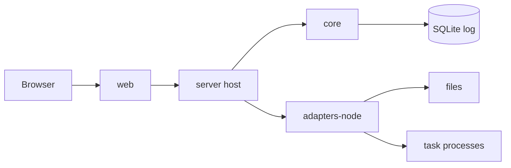
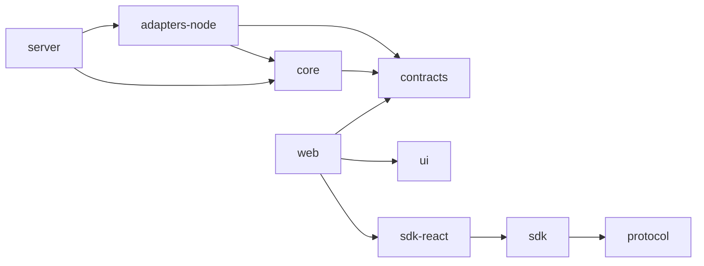
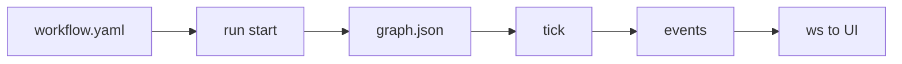

# Architecture

> Superseded in part by [DES-031](des-031-node-workflows.md) (node workflows, 2026-11-22): spawn in the data flow and failure modes is removed; the engine walks nodes ([DES-034](des-034-node-engine.md)).
> Target v2 shape (core + adapters-node host, protocol, ACP agents, Electron): [DES-039](des-039-system-architecture-v2.md). `packages/engine` and `packages/shared` are gone (BL-213, BL-215).

High-level map. Details live in the linked designs; entities are in
[DES-001](des-001-overview.md).

## System context

Everything runs on one Mac. The browser talks only to the local server
(or desktop utility host); the host composes core behind ports; adapters
own Node I/O (log, files, processes).

## Containers

| Container      | What it is                                                       | Detail       |
| -------------- | ---------------------------------------------------------------- | ------------ |
| `apps/web`     | Vite and React UI, shadcn, React Flow, CodeMirror                | DES-008, 012 |
| `apps/server`  | Hono on `@hono/node-server`, `127.0.0.1:8787`, FCP over ws       | DES-001, 040 |
| Host           | `createHost` in `adapters-node/host` + core runs / FCP binding   | DES-039      |
| Event log      | SQLite `app.db`: append-only `events`, plus `settings` (DES-019) | DES-003, 019 |
| Files          | `FLOWAPP_HOME` (default `~/.flowapp`): workflows, runs, logs     | DES-002      |
| Task processes | commands, scripts, agent CLIs, each in its own process group     | DES-003, 005 |
| Sandbox        | `sandbox-exec` around task processes, warned fallback            | DES-006      |

## Packages and dependency direction

| Package                  | Owns                                                       | May import                           |
| ------------------------ | ---------------------------------------------------------- | ------------------------------------ |
| `packages/contracts`     | zod schemas, branded ids, FCP, workflow, events            | nothing in the repo                  |
| `packages/core`          | domain, ports, run engine, node kinds, FCP binding         | `contracts`, `protocol` (types)      |
| `packages/adapters-node` | Node ports + `src/host` composition (`createHost`)         | `core`, `contracts`                  |
| `apps/server`            | HTTP, FCP ws, blob routes, host composition                | `core`, `adapters-node`, `contracts` |
| `apps/web`               | screens and client state; talks through sdk-react          | `contracts`, `ui`, `sdk-react`       |
| `packages/ui`            | shadcn components, styles, domain-free AI Element patterns | nothing in the repo                  |
| `packages/docs-tools`    | docs index generator and checker                           | nothing in the repo                  |
| `apps/e2e`               | Playwright tests against server and web                    | nothing (HTTP only)                  |

The web talks only through FCP (sdk-react); it never reads files or the
database directly. Core stays free of `node:` imports.

## Data flow

1. The user edits `workflow.yaml` in the editor or on disk; the server
   validates it with the shared schema and writes it (DES-013).
2. Starting a run copies the workflow into `runs/<runId>/graph.json`, the
   run's own graph.
3. Each tick computes ready tasks under the limits, appends events, then
   launches processes. Agents may spawn tasks into `graph.json` (DES-005).
4. Every event is pushed over the websocket; the UI folds them into the
   views it shows (DES-009).
5. Controls (cancel, retry, approve, delete) are HTTP calls that become
   events (DES-011).

## Runtime processes

| Process            | Started by        | Lifetime                                     |
| ------------------ | ----------------- | -------------------------------------------- |
| Server plus engine | `pnpm dev` (tsx)  | long running, one per machine                |
| Vite dev server    | `pnpm dev`        | development only                             |
| Task attempt       | engine tick       | one per attempt, detached, own process group |
| Agent CLI          | engine, as a task | one per attempt, stateless                   |

## Failure modes and recovery

| Failure                        | Recovery                                                                               |
| ------------------------------ | -------------------------------------------------------------------------------------- |
| Server or Mac restarts mid-run | replay the log; re-attach live pids, else `interrupted` and the retry policy (DES-003) |
| Crash between event and action | append-then-act and pre-written attempt ids prevent duplicates                         |
| Crash during run deletion      | the deleted marker is already logged; resume removes the files                         |
| Task hangs                     | timeout ends its process group; retry policy applies (DES-004, 019)                    |
| Agent spawns too much          | `maxTasks` and `maxSpawnDepth` reject specs; cancel the run                            |
| Sandbox unavailable            | task runs unrestricted with a warning badge (DES-006)                                  |
| Websocket drops                | alert in the run header; data stays, marked stale until reconnect (DES-009)            |
| Invalid `workflow.yaml`        | errors shown on fields and in YAML; last valid graph kept (DES-010)                    |
