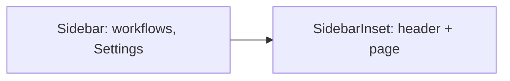

# UI on the shadcn baseline

> Superseded in part by the UI renovation (draft, lands with BL-057 to BL-072): control sizes that keep `sm` buttons next to 32px inputs; see the spec sheet in [DES-027](des-027-ui-renovation.md).

The app already runs on shadcn `base-nova` (Base UI, neutral,
lucide) with 28 components in `packages/ui/src/components`. This
design keeps that system as it is and brings our own components
in line with it. It replaces the unmerged token and density draft
on branch `docs/des-024-ui-foundation`.

## Rule

shadcn defaults are the only style source. Spacing, radius, type,
control sizes, colors and fonts stay exactly as `base-nova`
generates them. There is no custom spacing scale, no density
setting, no theme reset and no custom lint scale.

Customize only through shadcn's own mechanisms:

- Add a component with `shadcn add <name>` (preview with
  `--dry-run` first). Never edit a generated file in
  `packages/ui/src/components` by hand.
- Pick a look with the component's props (`variant`, `size`),
  not with class overrides that restate or fight them.
- Change a color or the radius only in the CSS variables of
  `packages/ui/src/styles/globals.css`, in the form shadcn
  generates them.
- Use semantic tokens (`text-muted-foreground`, `bg-card`,
  `text-destructive`), never palette colors.
- Layout classes (`flex`, `gap-*`, `p-*`, `min-h-*`) in app code
  use Tailwind's default scale steps, not `-[...]` values.

## What shadcn gives us

Checked in the generated files on `develop` (`df3dad3`). A dry run
of `shadcn add` for all 28 components reports 18 identical and 10
that differ only by a `"use client"` line, so the kit is unedited.

| Part          | base-nova default                                                                                                                           |
| ------------- | ------------------------------------------------------------------------------------------------------------------------------------------- |
| Radius        | `--radius: 0.625rem`; controls `rounded-lg`, cards, dialogs and empty states `rounded-xl`, menu items `rounded-md`, badge `rounded-4xl`     |
| Button        | `default` h-8 px-2.5 gap-1.5; `xs` h-6; `sm` h-7 text-[0.8rem]; `lg` h-9; `icon` size-8 (`icon-xs` 6, `icon-sm` 7, `icon-lg` 9); svg size-4 |
| Input, Select | h-8 (`sm` select h-7), `rounded-lg`, px-2.5, `text-sm` from md                                                                              |
| Textarea      | min-h-16, px-2.5 py-2, `rounded-lg`                                                                                                         |
| Badge         | h-5 px-2 `text-xs`, svg size-3                                                                                                              |
| Card          | `--card-spacing` 4 (gap and padding), `rounded-xl`, `text-sm`; `size="sm"` variant; title `font-heading text-base font-medium`              |
| Dialog        | p-4 gap-4 `rounded-xl`, `sm:max-w-sm`; title `font-heading text-base font-medium`; footer p-4 on `bg-muted/50`                              |
| Table         | head h-10 px-2, cell p-2, `text-sm`                                                                                                         |
| Empty         | p-6 gap-4 `rounded-xl` dashed; media size-8; title `font-heading text-sm`                                                                   |
| Field         | group gap-5, set gap-4, label and description `text-sm`                                                                                     |
| Alert         | px-2.5 py-2 `rounded-lg`, `default` and `destructive`                                                                                       |
| Progress      | h-1                                                                                                                                         |
| Fonts         | Geist (`font-sans`), Figtree (`font-heading`)                                                                                               |

`shadcn add sidebar --dry-run` resolves for `base-nova`: it adds
`sidebar`, `sheet` and `hooks/use-mobile`, and the other files it
needs are already identical.

## Divergence inventory

Scan of `apps/web/src/**/*.tsx` on `df3dad3` (tests excluded):
13 arbitrary values, 4 palette colors, 15 `text-xs` helper texts
where shadcn uses `text-sm`, 8 hand-rolled error lines, 6
hand-styled links, 5 dialogs whose width never applies, 2
hand-rolled graph nodes, and a hand-rolled shell. No inline
`style`.

The worst one is a real bug. `DialogContent` has `sm:max-w-sm`,
and `className="max-w-2xl"` does not remove it, so from 640px up
these dialogs are 24rem wide. Use the `sm:` prefix, as
`MemoryCollisionDialog` already does.

### Shell and home

| Where                                                                                                                                         | Today                                                                                       | Use instead                                                   |
| --------------------------------------------------------------------------------------------------------------------------------------------- | ------------------------------------------------------------------------------------------- | ------------------------------------------------------------- |
| `App.tsx:11`                                                                                                                                  | `nav w-44 border-r p-4` with a `ul` of links                                                | `Sidebar`, `SidebarMenu`, `SidebarMenuButton`                 |
| `App.tsx:26`, `WorkflowEditorPage.tsx:84`, `RunViewPage.tsx:66`                                                                               | `main p-6`, then `-m-6 h-[calc(100svh)]` and `h-[calc(100svh-3rem)]` to undo it             | `SidebarInset`; pages fill with `flex-1 min-h-0`              |
| `App.tsx:29`, `main.tsx:17`                                                                                                                   | `Toaster` mounted twice                                                                     | one `Toaster`                                                 |
| `HomePage.tsx:114`, `WorkflowRunsPage.tsx:103`, `WorkflowEditorPage.tsx:86`                                                                   | three title styles (`text-lg`, `font-mono text-lg`, `font-mono text-sm`), no `font-heading` | one page header: `SidebarTrigger`, `Separator`, `Breadcrumb`  |
| `App.tsx:19`, `HomePage.tsx:163`, `WorkflowRunsPage.tsx:105`, `WorkflowRunsPage.tsx:150`, `WorkflowEditorPage.tsx:104`, `MemoryPanel.tsx:107` | `underline-offset-4 hover:underline` by hand; a raw `button`                                | `Button variant="link"` (or `ghost`) with `render={<Link />}` |
| `HomePage.tsx:126`                                                                                                                            | always-trust row on the home page                                                           | Settings, as an `Item`                                        |
| `HomePage.tsx:144`, `WorkflowRunsPage.tsx:121`                                                                                                | `Empty` without `EmptyHeader` and `EmptyMedia`; empty `EmptyContent`                        | full `Empty` structure, action inside `EmptyContent`          |

### Editor

| Where                                                                                                                                                      | Today                                                                    | Use instead                                                             |
| ---------------------------------------------------------------------------------------------------------------------------------------------------------- | ------------------------------------------------------------------------ | ----------------------------------------------------------------------- |
| `EditorGraph.tsx:25`                                                                                                                                       | node `div min-w-[160px] rounded-md border bg-card px-2 py-1.5 shadow-sm` | `Card size="sm"` in the React Flow node, `min-w-40`                     |
| `EditorGraph.tsx:70`                                                                                                                                       | `min-h-[280px]`                                                          | `min-h-70`                                                              |
| `YamlPane.tsx:34`                                                                                                                                          | `min-h-[160px]`                                                          | `min-h-40`                                                              |
| `YamlPane.tsx:53`                                                                                                                                          | editor frame `rounded-md border`                                         | `rounded-lg border-input`, like `Input`                                 |
| `InputDeclRow.tsx:25`                                                                                                                                      | `li rounded-md border p-2` panel                                         | `Card size="sm"` with a `FieldGroup`                                    |
| `InputDeclRow.tsx:34`                                                                                                                                      | `size="sm" variant="ghost"` plus `h-7 text-destructive`                  | `variant="destructive" size="sm"`, no class                             |
| `InputsPanel.tsx:55`, `Inspector.tsx:156`                                                                                                                  | `border-t pt-3` dividers, `h2`/`h3` `text-sm` titles                     | `Separator`, `FieldSet` and `FieldLegend`                               |
| `Inspector.tsx:53`, `Inspector.tsx:82`                                                                                                                     | `space-y-3 p-3`                                                          | `FieldGroup`, panel padding `p-4` like Card                             |
| `Inspector.tsx:71`, `Inspector.tsx:98`, `InputsPanel.tsx:70`, `InputsPanel.tsx:112`, `MemoryPanel.tsx:96`, `AgentTaskFields.tsx:96`, `InputDeclRow.tsx:29` | helper text `text-xs text-muted-foreground`                              | `FieldDescription`                                                      |
| `MemoryPanel.tsx:100`                                                                                                                                      | `ul` rows with a raw `button` and two ghost buttons                      | `ItemGroup` and `Item` with `ItemActions`                               |
| `WorkflowEditorPage.tsx:67`                                                                                                                                | `Skeleton h-[480px]`                                                     | `h-120`                                                                 |
| `WorkflowEditorPage.tsx:123`, `:131`, `:156`                                                                                                               | panel padding `p-4`, `p-2`, `p-3`                                        | `p-4`                                                                   |
| `FileEditorDialog.tsx:46`, `ConflictDialog.tsx:32`                                                                                                         | `max-w-2xl` (never applies)                                              | `sm:max-w-2xl`                                                          |
| `FileEditorDialog.tsx:55`                                                                                                                                  | `Textarea min-h-[280px]`                                                 | `min-h-70`                                                              |
| `ConflictDialog.tsx:42`, `:45`                                                                                                                             | `pre rounded border p-2`                                                 | `rounded-lg border p-2` now, Code Block in phase 2                      |
| `DeleteTaskDialog.tsx:38`                                                                                                                                  | `text-amber-700 dark:text-amber-400`                                     | `Alert` with a lucide icon                                              |
| `FileEditorDialog.tsx:57`, `MemoryPanel.tsx:137`                                                                                                           | `p text-sm text-destructive`                                             | `FieldError`, or `Alert variant="destructive"` when not tied to a field |

### Run view

| Where                                           | Today                                                       | Use instead                                                               |
| ----------------------------------------------- | ----------------------------------------------------------- | ------------------------------------------------------------------------- |
| `TaskGraph.tsx:27`                              | same hand-rolled node as the editor                         | `Card size="sm"`, `min-w-40`                                              |
| `TaskGraph.tsx:64`                              | `min-h-[320px]`                                             | `min-h-80`                                                                |
| `RunViewPage.tsx:51`                            | `Skeleton h-[400px]`                                        | `h-100`                                                                   |
| `RunHeader.tsx:48`                              | own `header border-b pb-4` with the breadcrumb              | the shared page header                                                    |
| `RunHeader.tsx:86`                              | `Progress className="h-2"`                                  | default `Progress`                                                        |
| `RunHeader.tsx:87`, `:116`                      | `text-xs` meta                                              | `text-sm text-muted-foreground` or a `Badge`                              |
| `TaskDetail.tsx:100`                            | log box `h-[min(50vh,400px)] rounded-md border bg-muted/30` | `flex-1 min-h-0 rounded-lg border` now, Terminal in phase 2               |
| `TaskDetail.tsx:196`, `TaskDetailOutput.tsx:56` | plain `ul` lists of children and outputs                    | `Item` list now, File Tree in phase 2                                     |
| `RunInputFiles.tsx:60`                          | `h2 text-xs` section title                                  | the same section title style as the editor (`FieldLegend` or `CardTitle`) |
| `RunInputFiles.tsx:72`, `:82`                   | `size="sm"` plus `h-7 font-mono text-xs`                    | `size="sm"` plus `font-mono` only                                         |
| `RunInputFiles.tsx:100`                         | `max-w-2xl` (never applies)                                 | `sm:max-w-2xl`                                                            |
| `RunInputFiles.tsx:111`                         | `pre max-h-[60vh] rounded-md`                               | `ScrollArea max-h-96 rounded-lg border`, Code Block in phase 2            |
| `RunInputFiles.tsx:109`                         | `p text-sm text-destructive`                                | `Alert variant="destructive"`                                             |
| `TaskActions.tsx:53`                            | `ButtonGroup className="mb-2"`                              | spacing from the parent `gap`                                             |

### Dialogs and forms

| Where                                                                                                                                              | Today                                                       | Use instead                                                 |
| -------------------------------------------------------------------------------------------------------------------------------------------------- | ----------------------------------------------------------- | ----------------------------------------------------------- |
| `TrustDialog.tsx:37`, `StartRunForm.tsx:102`                                                                                                       | `max-w-lg` (never applies)                                  | `sm:max-w-lg`                                               |
| `TrustDialog.tsx:60`                                                                                                                               | `text-amber-700 dark:text-amber-400` for warn               | `Badge variant="outline"` with a lucide icon, or `Alert`    |
| `TrustDialog.tsx:49`                                                                                                                               | `ul max-h-60 space-y-2` checks                              | `ItemGroup` in a `ScrollArea`                               |
| `StartRunFormFields.tsx:35`                                                                                                                        | `max-h-[min(60vh,420px)]`                                   | `max-h-96` in a `ScrollArea`                                |
| `StartRunFormFields.tsx:43`, `:72`, `:103`                                                                                                         | `text-xs` helper text                                       | `FieldDescription`                                          |
| `StartRunFormFields.tsx:80`, `CreateWorkflowDialog.tsx:94`, `RenameWorkflowDialog.tsx:109`, `DeleteWorkflowDialog.tsx:101`, `StartRunForm.tsx:119` | `p text-sm text-destructive`                                | `FieldError` on a field, else `Alert variant="destructive"` |
| `MemoryFileDialogs.tsx:69`, `:97`, `MemoryEditorDialog.tsx:121`                                                                                    | `AlertDialogContent size="default" className="sm:max-w-md"` | `size="default"` with no width class                        |

Line numbers are from `df3dad3` and will drift; the lint rule
below is what keeps the list honest.

## Target layout

Shell: `SidebarProvider`, `Sidebar` and `SidebarInset` from
`shadcn add sidebar`, at its default width and default
`collapsible="offcanvas"` (a Sheet on mobile, never icon-only).

- `SidebarHeader`: app name.
- `SidebarGroup` "Workflows": one `SidebarMenuButton` per
  workflow, `SidebarGroupAction` to create, and a
  `SidebarMenuAction` dropdown for rename and delete (existing
  dialogs).
- `SidebarFooter`: a Settings link.

Page header, the same on every page: `SidebarTrigger`, a vertical
`Separator`, a `Breadcrumb` (Workflows, workflow id, Runs, run
id), then page actions on the right. The Advanced `Switch` sits
here on the editor until BL-037; the run view no longer uses it
(BL-036 / DES-025).

The index route shows an `Empty` ("Select a workflow or create
one") instead of a second workflow table.

`/settings` is a `FieldGroup` page:

- Theme: light (default), dark or system, as a `ToggleGroup`.
  `ThemeProvider` default becomes `light`; `d` still toggles.
- CLI info, read-only: one `Item` per CLI with a `Badge` for
  installed and version, and the default model and effort from
  DES-023 when that API exists. The app never writes CLI files.
- Always-trust and revoke, moved from the home page (DES-019).

## Progressive disclosure

One UI. Advanced is a `Switch` stored in `localStorage` as
`flows-advanced`, shared by all screens.

| Screen   | Default                                                                                  | Behind Advanced |
| -------- | ---------------------------------------------------------------------------------------- | --------------- |
| Editor   | Graph, Inspector, prompts, memory, inputs                                                | YAML pane       |
| Run view | Output, Terminal, Attempts, Environment tabs for every user (BL-036); no Advanced switch | —               |

A YAML parse error with Advanced off still shows an `Alert` with
a button that opens Advanced.

## AI Elements by phase

AI Elements are copy-in patterns, not a package
([docs](https://ui.shadcn.com/docs/ai-elements)). Add their base
with `shadcn add trace code-block`, then copy a pattern into
`apps/web/src/components/ai-elements/` and keep its classes as
shipped. Graph parts were dropped upstream; the graph stays React
Flow with Card and Button Group (DES-010, DES-012).

| Phase        | Backlog | Adopt                                                                                     |
| ------------ | ------- | ----------------------------------------------------------------------------------------- |
| 1 Foundation | BL-027  | Sidebar shell, Settings, alignment, lint guard                                            |
| 2 Run view   | BL-028  | Terminal, Task, Plan, Stack Trace, File Tree, Confirmation; env as Item, Badge and Switch |
| 3 Editor     | BL-029  | Model Selector (DES-023), Prompt Input, Advanced YAML                                     |
| 4 Polish     | BL-030  | Sidebar list states, Kbd hints; command palette later                                     |

### Phase 4 polish (BL-030)

Done: `SidebarMenuSkeleton` while loading, `Empty` when the
workflow list is empty, long lists scroll in `SidebarContent`
with Settings in `SidebarFooter`, and Settings shows the `d`
theme shortcut with `Kbd`.

BL-030 sweep residual (fixed or accepted):

| Finding                                                                                  | Disposition                                      |
| ---------------------------------------------------------------------------------------- | ------------------------------------------------ |
| Helper / meta `text-xs` in app screens                                                   | Fixed to `text-sm` or Card default               |
| Inline `Button variant="link"` with `h-auto p-0` in table and Item titles                | Accepted: link size has no unpadded option       |
| `DialogContent className="sm:max-w-*"`                                                   | Accepted: Dialog has no matching width size prop |
| CodeMirror, file Textarea, conflict/preview `pre`, SummaryMarkdown inline code `text-xs` | Accepted: code density                           |
| `apps/web/src/components/ai-elements/*` shipped classes                                  | Accepted: keep AI Elements as copied             |
| `PageHeader` Separator `h-4`                                                             | Accepted: matches the shadcn sidebar recipe      |

No hand-rolled copy of an installed shadcn component was found.

Tool, Reasoning and Subagent wait for a structured CLI event log.

## Keeping it stable

- Lint, `apps/web` only: an ESLint `no-restricted-syntax` rule
  (core ESLint, no new plugin) fails a class string that has an
  arbitrary utility value (`-[` outside a `data-`, `aria-`,
  `has-` or `group-` variant) or a palette color (`text-amber-*`,
  `bg-white` and the like). `packages/ui/src/components` is not
  linted for this: generated files use arbitrary values on
  purpose (`rounded-[min(var(--radius-md),10px)]`,
  `text-[0.8rem]`).
- Generated files stay generated: `shadcn add <all> --dry-run`
  shows only identical files or `"use client"` noise.
- `globals.css` changes only as `shadcn add` or `shadcn init`
  writes it.
- Every UI change ships Playwright screenshots and video of the
  screens it touches, light and dark.

## Out of scope

A custom token or density system, a second "simple" app, an
icon-only sidebar, a command palette, and structured agent
events.
