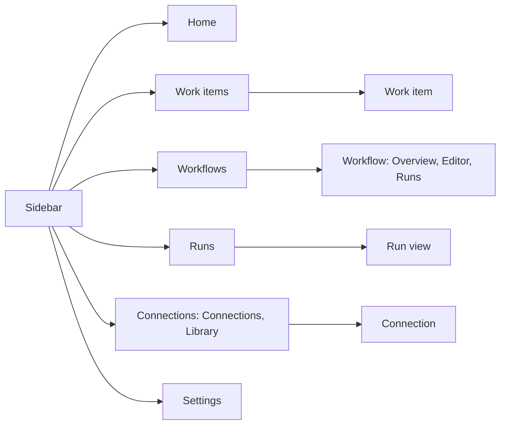

# Journey-led UI redesign

> Superseded in part by the UI renovation (draft, lands with BL-057 to BL-072): layout rule 1 (the `p-6` frame), "Pages", "Developer experience" and the Start card answer; see [DES-027](des-027-ui-renovation.md) to [DES-030](des-030-ui-renovation-journeys-dx.md).

Phase 13 ([DES-024](des-024-ui-shadcn-baseline.md)) removed stray values.
This design arranges the same shadcn parts around what people do. The
model behind it (work items, library, connections, publish policy, and
the folders) is in [DES-026](des-026-work-items-library-connections.md).
There is no Simple mode: every detail stays visible, placed where it
helps (a Table column, a Tab, a Badge). Clickable mockups were shared as
an artifact in the session that wrote this doc; they are not in the repo.

## Decisions

| Topic       | Decision                                                                                      |
| ----------- | --------------------------------------------------------------------------------------------- |
| Audience    | Non-tech users (product owner, analyst) and developers, one UI for both                       |
| Modes       | None. The Advanced switch goes; its content moves into Tabs (Terminal, Attempts, Environment) |
| Style       | shadcn `base-nova` and AI Elements only (DES-024); no new tokens, no custom scale             |
| Build rule  | One component per job (table below); compose, never restyle                                   |
| Scope       | One shell, header and card pattern for all pages, built in phases 14 to 18 (DES-017)          |
| Entry point | The work item, not the workflow: pick the work, then a workflow to apply                      |
| Navigation  | Home, Work items, Workflows, Runs, Connections (Library is a tab); later Bots and Logs        |
| Safety      | Tasks work on pulled data; only a publish task the user placed sends anything out, gated      |

## User journeys

| Id  | Who              | Goal                                             | Path                                                                  |
| --- | ---------------- | ------------------------------------------------ | --------------------------------------------------------------------- |
| J1  | Product owner    | Go from an empty first launch to a first result  | Empty Home, new work item, work item page, trust check, watch the run |
| J2  | Product owner    | Pick up a work item and run a workflow on it     | Work items, open one, check context freshness, start                  |
| J3  | Business analyst | Reuse one workflow for many work items           | Workflow Start card asks the work item; second item; runs by item     |
| J4  | Product owner    | Approve work that is waiting                     | Home "Needs you", open run, read summary and output, approve          |
| J5  | Business analyst | Find out why a run failed and fix it             | Runs, failed run, Terminal, Stack Trace, jump to the task             |
| J6  | Business analyst | Build a workflow and change a task               | Editor graph, pick a task, write the prompt, Save                     |
| J7  | Business analyst | Connect a source and decide how changes go back  | Connections, add, fix a sign-in, set the publish policy               |
| J8  | Business analyst | Use different sources in different tasks         | Impact summary, task one (Rally, Confluence), task two (GitHub), pins |
| J9  | Product owner    | Review changes before they reach a shared system | Home, publish task waiting with warning and preview, publish, ledger  |
| J10 | Developer        | See what is pulled, how fresh, and what uses it  | Library tab, refresh rule, run pins                                   |
| J11 | Developer        | Know the impact of a mistake and undo it         | Effects ledger, clear an entity, tighten a policy                     |
| J12 | Developer        | Add a source Flows does not know yet             | Add an in-repo connector adapter; same pages as built-ins             |
| J13 | Developer        | Set up the machine and inspect a run             | Settings, Attempts, Terminal                                          |

What the journeys demand of the UI:

- **J1, J2** need the work item to be the front door: context, runs and a
  Start card on one page, and a first launch with one clear action.
- **J3** needs the Start card to ask for the work item and prefill from it,
  and Runs to group by work item.
- **J4, J9** need anything waiting on a person first on Home and first on a
  run, with the evidence one click away.
- **J5** needs failure to be loud and the cause one Tab away.
- **J6, J8** need nodes that show the connections a task uses, and an
  Inspector made of plain Fields.
- **J7** needs one page per connection: sign-in, local data, policy.
- **J10, J11** need freshness, pins and impact (Read, Local, Cloud) to be
  visible, with an undo note on every effect.
- **J12** needs a new source to reuse the same pages.

## One component per job

| Job                          | Component (shadcn core or AI Elements)                                                            |
| ---------------------------- | ------------------------------------------------------------------------------------------------- |
| App shell                    | `Sidebar` + `SidebarInset`, `PageHeader` (Trigger, Separator, Breadcrumb)                         |
| Page title                   | `font-heading text-xl` title, one muted sentence, optional Badge                                  |
| Section                      | `h2 font-heading text-base`, content below with `gap-3`                                           |
| Group of facts or actions    | `Card` (`size="sm"` in grids), `CardAction` for the badge                                         |
| Rows you click               | `ItemGroup` + `Item`, or `Table` when columns matter                                              |
| Run status                   | `Badge` with icon: secondary done, outline running, default awaiting approval, destructive failed |
| Impact                       | `Badge`: secondary Read, outline Local, default Cloud                                             |
| Publish policy               | `Badge` with icon; chosen with `Select`, explained in `FieldDescription`                          |
| Freshness                    | `Badge`: secondary Fresh, outline Stale                                                           |
| Source of a work item        | outline `Badge` with the system icon, or secondary "Ad hoc"                                       |
| Forms                        | `FieldGroup`, `Field`, `Input`, `Textarea`, `Select`, `Switch`                                    |
| Prompt with model and effort | Prompt Input with Model Selector in its footer                                                    |
| Waiting on a person          | Confirmation (`Item variant="outline"`, Reject and Approve)                                       |
| Task progress                | Plan (known steps) and `Progress`; Task for live steps                                            |
| Logs and failures            | Terminal, Stack Trace, Code Block inside `Tabs variant="line"`                                    |
| Change preview               | Code Block with a diff                                                                            |
| Outputs                      | File Tree or `Item` list                                                                          |
| Empty and loading            | `Empty` with `EmptyHeader`, `EmptyMedia`; `Skeleton`                                              |
| Add or confirm               | `Dialog` with `DialogFooter`; `AlertDialog` only to delete                                        |
| Graph                        | React Flow with `Card size="sm"` nodes, `ButtonGroup` controls                                    |

AI Elements has no canvas pattern; the graph stays React Flow. Queue,
Chain of Thought, Tool and Subagent wait until Bots exist.

## Shell and navigation

- Sidebar: group "Platform" (Home, Work items, Workflows, Runs,
  Connections, later Bots and Logs), group "Workflows" with a create
  action, Settings in the footer.
- Every page: `PageHeader`, then a `p-6` column with `gap-6`.
- Workflow detail and Connections use `Tabs variant="line"`.
- Routes: `/`, `/work-items`, `/work-items/:id`, `/workflows`,
  `/workflows/:id` (tab as search param), `/runs`, `/runs/:runId`,
  `/connections` (tab as search param), `/connections/:id`, `/settings`.
  Old nested URLs redirect.

## Layout rules

1. One page template: header, then `p-6` with `gap-6`.
2. One section title: `font-heading text-base`, `gap-3` to its content.
3. One surface: `Card` (`rounded-xl`, `--card-spacing`). Lists use `Item`;
   no card inside a card.
4. One control size per row: default `h-8`; `sm` or `xs` only in dense
   lists and card actions.
5. One status look per meaning: run status, impact, policy and freshness
   each have their own Badge mapping; never color alone.
6. Spacing steps `1, 2, 3, 4, 6`: `gap-2` inside control groups, `gap-4`
   between fields and card content, `gap-6` between sections.
7. `font-mono` only for ids, commands, paths and logs, never for names.
8. Helper text is `FieldDescription`; errors are `FieldError` or `Alert`.

## Pages

- **Home**: Needs you (approvals, waiting publish tasks, expired sign-ins),
  Running, Work items, Recent runs.
- **Work items**: search plus a Table (source, workflow, last run).
- **Work item**: Context (library entities with freshness), Runs, a Start
  card (workflow, prefilled inputs, trust check), and Notes.
- **Workflows**: search plus a Table with last-run Badge.
- **Workflow Overview**: Tasks with their connections, Connections and
  impact, Inputs, and a Start card that asks for the work item.
- **Editor**: graph canvas plus an Inspector Card with a Connections
  FieldSet (use it, and Read or Propose changes). A publish task is a
  node like any other, added from the canvas with a connection Select.
- **Runs**: one Table by work item.
- **Run view**: Confirmation or Alert, Progress, Changes to publish (a
  waiting publish task) or Effects and unpublished local changes, Plan
  beside a task Table, a task Card with Tabs, and Library pins
  (revision, freshness, used by).
- **Connections**: the three-step explainer and a Table; **Library** tab:
  entities, revisions, freshness, pinned by; **Connection**: local data,
  used by, publish policy, sign-in.
- **Settings**: theme, agent CLIs, always-trust, allowed MCP servers.

## Developer experience

- `/dev/kit` renders each shared pattern (title block, status Badge, task
  Card, Confirmation, Plan, impact, policy and freshness Badges) in light
  and dark.
- Playwright screenshots of `/dev/kit` and each page act as the visual
  check for the layout rules.
- The two lint rules from DES-024 stay; add one banning `className` on
  shadcn parts for size or radius.

## Resolved questions

- **Label.** "Work items" is final, in the Sidebar and everywhere, with
  no short form. The Sidebar width fits it.
- **Start card inputs.** The Start card on a workflow asks for the work
  item (or "None, ad hoc"). Declared inputs are prefilled from it and
  stay editable for this run. A run keeps what was submitted; the work
  item's own values do not change.
- **Conflict and escalation states.** A publish conflict fails the
  publish task and shows an Alert with "Rerun with fresh pull". An agent
  review that escalates becomes the same "Awaiting approval" Confirmation
  as a person-reviewed policy; Discard is Reject. Both reuse existing
  parts.
- **Waiting on a person.** Run status does not change. The run summary
  has `needsYou`, derived from tasks in `awaiting_approval` (a publish
  task carries its connection); the "Awaiting approval" Badge and Home's
  Needs you read it.
- **When to publish.** The user decides by placing a publish task in
  the graph (DES-026). Without one, changes stay Local.
- Model questions (secrets, resources on disk, change sets, agent
  review, retention, work copies, first source) are resolved in DES-026.

## Done when

Backlog phases 14 to 18 in [DES-017](des-017-roadmap.md): the shell on
today's data (BL-031 to BL-037), work items (BL-038 to BL-041), then
connections and publish (BL-042 to BL-056, with DES-026). Bots and
Logs have no backlog item yet.
