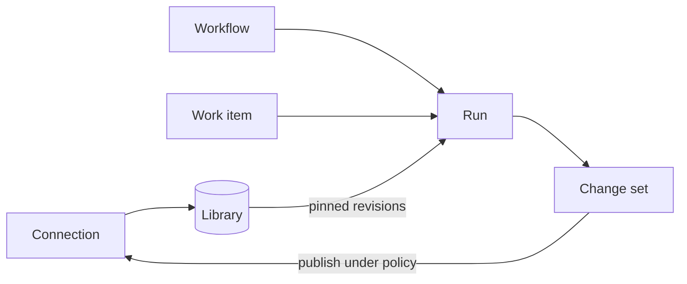

# Work items, library and connections

A workflow may use many outside systems (GitHub, Confluence, Rally,
Jenkins, OpenSearch), and one workflow is applied to many pieces of work.
This doc defines the model and the folders. Nothing here is built; the
work is BL-038 to BL-056 and the UI is in
[DES-025](des-025-journey-led-redesign.md).

## Concepts

| Concept     | Meaning                                                                          | Where it lives                 |
| ----------- | -------------------------------------------------------------------------------- | ------------------------------ |
| Connection  | A configured outside system: scope, sign-in method, publish policy, refresh rule | `connections/<id>/`            |
| Library     | Central local store of data pulled through connections, by entity and revision   | `library/<connectionId>/`      |
| Work item   | The user's unit of work: a story, defect or ad-hoc request. A saved record      | `workitems/<id>/`              |
| Workflow    | A reusable recipe (DES-002); unchanged                                           | `workflows/<id>/`              |
| Run         | A workflow applied to a work item, with inputs and pinned library revisions      | `workflows/<id>/runs/<runId>/` |
| Change set  | What a task proposes to change in a source: the diff of a work copy vs its base  | `runs/<runId>/changes/`        |
| Effect      | One recorded result: Local or Cloud, published or kept, with an undo note        | events in `app.db`             |

"Task" keeps meaning a workflow node. The user's thing is a work item.



## Work items

- Many work items use one workflow, each with its own inputs. One work
  item can run several workflows over time. There are no stages: its
  history is its runs.
- A work item is created from a source item (a Rally story, a Confluence
  page) or ad hoc, with no backlog entry.
- It holds links to library entities (its context), the user's own notes,
  and attachments. Its runs are found by `workItemId` in the event log.
- It generalizes `itemKey` and `inputs.json` of DES-021: a run's inputs
  come from the work item, and the duplicate check can warn per item.

## Folder layout

```
~/.flowapp/
  app.db                                  # events and indexes
  connections/<connectionId>/connection.yaml   # config and policy; no secrets
  library/<connectionId>/
    <entityKind>/<entityId>/
      <revision>/...                      # immutable snapshot
      current -> <revision>               # latest pull
  secrets/<connectionId>/                 # cookies.json, profile/; 0700, unreadable by tasks
  workitems/<workItemId>/
    workitem.yaml                         # title, source link, workflow, inputs, library links
    notes.md  attachments/
  workflows/<workflowId>/
    workflow.yaml  tasks/  memory/  ...   # tasks gain `uses:`
    runs/<runId>/
      input/ inputs.json                  # adds workItemId
      resources.json                      # pins: connection, entity, revision
      work/<connectionId>/                # work copy, only for `propose`
      changes/<connectionId>/             # changeset.json, preview.md
```

Only `secrets/` holds sign-in data; see Secrets below.

```yaml
# workflow.yaml, per task
uses:
  - { connection: rally-payments, access: read }
  - { connection: github-acme-api, access: propose }
```

At task start Flows sets `RESOURCE_<ID>` to the pinned revision, or to
`work/<connectionId>/` when the access is `propose`.

## Pulling

- **By entity, on demand.** Starting a run resolves the work item's links
  and the workflow's `uses`, and pulls what is missing or older than the
  connection's refresh rule (15 minutes, 1 hour, 1 day, never).
- **Manual.** Pull now on a connection, a work item or a library entry.
- **Before publish.** Flows compares the remote revision with the pinned
  one. A difference is a conflict, shown like a git conflict.
- **Big sources** (a repo) are one shared clone; a revision is a commit.
- **Pinning.** A run records revisions in `resources.json`, so a rerun is
  reproducible. A refresh adds a revision and never edits one. Revisions
  no run pins can be cleared; clearing never loses a work item.

## Safety

- **Sandbox.** The library is outside the workflow folder, so the
  existing rule (writes only inside the workflow dir, DES-006) already
  makes it read-only to tasks. Only Flows writes it, when pulling.
- **Credentials.** Used only when pulling and publishing. A task process
  gets local paths, never credentials, and the sandbox denies it reads
  of `secrets/`. Command tasks still run as the user, so Flows warns
  about ambient logins (a `gh` session) instead of claiming to block
  them. Access is declared and warned, not enforced at the network.
- **Sign-in methods** are three, per connection and per connector: a
  CLI that owns its login (`cli`, the GitHub CLI), a local MCP server
  the user allowed (`mcp`, it owns its login), or session cookies from
  a browser sign-in (`cookies`). No API tokens and no Keychain. An
  expired sign-in stops pull and publish; tasks keep working on pulled
  data.
- **Impact.** Every effect is Read, Local or Cloud. Read and Local are
  redone by clearing and pulling again. Only a Cloud publish affects
  others.

| Publish policy         | Who reviews            | Use when                                        |
| ---------------------- | ---------------------- | ----------------------------------------------- |
| Read only (default)    | nobody; no publish     | the source is only context                      |
| Approve each publish   | a person, with warning | a mistake affects others or is hard to undo     |
| Trust agent review     | an agent, no pause     | a mistake is easy to undo (a draft pull request) |

The effects ledger lists each effect of a run (what, connection, impact,
result, undo note). It is derived from events, so it survives restarts.

## Extending

A connector is a small in-repo TypeScript adapter, the same strategy
pattern as the CLI adapters (DES-019) and source adapters (DES-021).
There is no plugin loading: a new source (J12) is a folder under
`packages/engine/src/connectors/` plus one registry line, added by a
pull request. The interface:

- `describe`: entity kinds, scope fields, supported sign-in methods
- `check`: is the sign-in valid
- `pull(entity)`: write one entity revision into the library
- `diff` and `publish(changeSet)`: build and apply a change set

The CLI, MCP or cookies are internal to the adapter. A new source adds
one adapter and reuses every page and rule above.

## Code layout (later)

```
packages/shared/src/connection.ts      # connection, uses, change set, events
packages/engine/src/connectors/        # types, registry, one folder per adapter
packages/engine/src/library.ts         # pull, pin, retention
packages/engine/src/resources.ts       # overlay, diff, policy gate
apps/server/src/routes/{connections,workitems,library}.ts
```

## Secrets

- No Keychain. Any process running as the user can read a Keychain item
  through `/usr/bin/security`, and agent CLIs read their own logins that
  way, so the sandbox could not hide it from tasks.
- `cli` and `mcp` store nothing in Flows: the CLI or the MCP server owns
  the login. An MCP server's command or URL is plain config in
  `connection.yaml`, and it runs only after the user allows it, the
  same trust flow as agent CLIs (DES-019).
- `cookies`: "Sign in with browser" opens the installed Chrome
  (`playwright-core`, channel `chrome`) with a dedicated profile under
  `secrets/<connectionId>/profile/`. When the window closes, Flows saves
  the domain's cookies to `secrets/<connectionId>/cookies.json` (file
  0600, folder 0700). The user's own Chrome profile is never read.
- The task sandbox denies `file-read*` under `secrets/`. An unsandboxed
  run warns that this protection is off. No secret is written to
  `workflow.yaml`, logs or the library.
- Revoke is one action on the connection page ("Remove sign-in"). It
  deletes `secrets/<connectionId>/`, marks the connection signed out,
  and leaves the library data in place.
- Cookies expire; a connector's `check` detects it and the UI says so.

## Work copies

- A `propose` task writes to `runs/<runId>/work/<connectionId>/`, inside
  the workflow dir, so the sandbox needs no change.
- A repo is `git clone --shared` from the library clone, checked out at
  the pinned commit. It reads objects from the library and writes new
  ones locally. No git worktree: its metadata lives in the library
  clone, outside the write root, so `git commit` would fail.
- The library clone keeps `gc.auto=0` and is pruned only when no live
  run has a work copy of it. Other sources use an APFS clone
  (`cp -cR`), with a plain copy as fallback.
- Copies never share files, but servers and tests can share ports. Each
  attempt gets a leased port block in env (`PORT`, `FLOWS_PORT_BASE`,
  `FLOWS_PORT_COUNT`). A repo with fixed ports sets `serial: true` on
  its connection, so its `propose` tasks run one at a time.
- Package caches (`npm_config_cache`, `PNPM_STORE_DIR`, `XDG_CACHE_HOME`
  and similar) point to `<workflow>/.cache/`, so installs work in the
  sandbox without writing to shared caches.

## Change sets and conflicts

Every connector writes the same envelope, `changeset.json`:
`{ v, connection, base, ops: [{ op, target, summary, destructive, payload }] }`.
`payload` is the adapter's own shape: a unified diff for files and
pages, an API call description for a comment or a status change. The
engine and UI read only the envelope and `preview.md`.

- `publish(changeSet)` returns `applied`, `conflict` or `rejected`.
- A conflict means the remote revision no longer equals `base`. Flows
  never merges. It shows the change set next to the new revision and
  offers two actions: pull again and rerun the task, or discard.
- Ops flagged `destructive` (delete, close, force push) always need a
  person, whatever the policy.

## Agent review

Under "Trust agent review", a judge agent (the agent-judge mechanism of
DES-004) reads `preview.md`, the change set and the task goal, plus an
optional `connections/<id>/review.md` of the user's rules. It returns
approve or escalate. Escalate, an error, a timeout or a destructive op
all fall back to "Approve each publish": Flows pauses and never
publishes on doubt. The verdict and its reason go in the effects ledger.
The judge uses the CLI and model defaults of DES-023.

## Retention

A revision pinned by any run is never removed, and `current` is always
kept. Unpinned revisions are removed after 7 days. The library has a size
cap in `config.yaml` (default 5 GB); at 80 percent the UI warns, and at
the cap pulls stop with a clear message instead of deleting pinned data.
Deleting a run releases its pins. Clearing an entity never touches a work
item.

## First source

GitHub comes first: its sign-in is delegated (no secrets for Flows), a
repo is one shared clone, and its change set is a branch and a draft
pull request, which is easy to undo. Confluence (MCP) and Rally
(cookies) follow, and they prove the other two sign-in paths.
