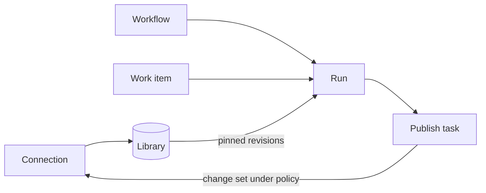

# Work items, library and connections

A workflow may use many outside systems (GitHub, Confluence, Rally,
Jenkins, OpenSearch), and one workflow is applied to many pieces of work.
This doc defines the model and the folders. Nothing here is built; the
work is BL-038 to BL-056 and the UI is in
[DES-025](des-025-journey-led-redesign.md).

## Concepts

| Concept      | Meaning                                                                          | Where it lives                 |
| ------------ | -------------------------------------------------------------------------------- | ------------------------------ |
| Connection   | A configured outside system: scope, sign-in method, publish policy, refresh rule | `connections/<id>/`            |
| Library      | Central local store of data pulled through connections, by entity and revision   | `library/<connectionId>/`      |
| Work item    | The user's unit of work: a story, defect or ad-hoc request. A saved record       | `workitems/<id>/`              |
| Workflow     | A reusable recipe (DES-002); tasks gain `uses` and a `publish` kind              | `workflows/<id>/`              |
| Run          | A workflow applied to a work item, with inputs and pinned library revisions      | `workflows/<id>/runs/<runId>/` |
| Work copy    | A run's writable copy of a connection's pinned entities, for `propose` tasks     | `runs/<runId>/work/`           |
| Publish task | A task the user places in the graph that sends a work copy's changes out         | a task with `kind: publish`    |
| Change set   | What a publish task sends: the work copy's diff against its base                 | `runs/<runId>/changes/`        |
| Effect       | One recorded result: Read, Local or Cloud, with an undo note                     | events in `app.db`             |

"Task" keeps meaning a workflow node. The user's thing is a work item.



## Work items

- Many work items use one workflow, each with its own inputs. One work
  item can run several workflows over time. There are no stages: its
  history is its runs.
- A work item is created from a source item (a Rally story, a Confluence
  page) or ad hoc, with no backlog entry.
- It holds links to library entities (its context), the user's own notes,
  and attachments. Its runs are found by `workItemId` in the event log.
- It generalizes `itemKey` and `inputs.json` of DES-021: a run's inputs
  come from the work item, and the duplicate check can warn per item.

## Folder layout

```
~/.flowapp/
  app.db                                  # events and indexes
  connections/<connectionId>/connection.yaml   # config and policy; no secrets
  library/<connectionId>/<entityKind>/<entityId>/
    <revision>/...                        # immutable snapshot
    current -> <revision>                 # latest pull
  secrets/<connectionId>/                 # cookies.json, profile/; 0700, unreadable by tasks
  workitems/<workItemId>/
    workitem.yaml                         # title, source link, workflow, inputs, library links
    notes.md  attachments/
  workflows/<workflowId>/
    workflow.yaml  tasks/  memory/  .cache/
    runs/<runId>/
      input/ inputs.json                  # adds workItemId
      resources.json                      # pins: connection, entity, revision
      resources/<connectionId>/<entityKind>/<entityId> -> library revision
      work/<connectionId>/<entityKind>/<entityId>/   # only with `propose`
      changes/<publishTaskId>/            # changeset.json, preview.md, result.json
```

Connection ids are lowercase slugs (`[a-z0-9-]`). Two ids that map to
the same env name are rejected.

## Resources on disk

- Each run gets `resources/`: read-only links to every pinned entity
  revision, plus `resources/index.json` (connection, kind, entity id,
  revision, title). `RESOURCES_DIR` points at it for every task, so the
  work item's context is readable by all tasks.
- A task that declares `uses` also gets `RESOURCE_<ID>` (the connection
  id in upper snake case) pointing at `resources/<connectionId>/`, or at
  `work/<connectionId>/` when its access is `propose`.

```yaml
# workflow.yaml
tasks:
  - id: implement
    kind: agent
    uses:
      - { connection: rally-payments, access: read }
      - { connection: github-acme-api, access: propose }
  - id: open-pr
    kind: publish
    connection: github-acme-api
    needs: [implement]
```

## Pulling

- **By entity, at run start.** Starting a run (queued runs too) resolves
  the work item's links and every task's `uses`, and pulls what is
  missing or older than the connection's refresh rule (15 minutes,
  1 hour, 1 day, never). Pins are frozen with the inputs (DES-021).
- **Manual.** Pull now on a connection, a work item or a library entry.
- **Big sources** (a repo) are one shared clone; a revision is a commit.
- **Pinning.** A run records revisions in `resources.json`, so a rerun is
  reproducible. "Rerun with fresh pull" pins again. A refresh adds a
  revision and never edits one. Revisions no run pins can be cleared;
  clearing never loses a work item.

## Safety

- **Sandbox.** The library is outside the workflow folder, so the
  existing rule (writes only inside the workflow dir, DES-006) makes it
  read-only to tasks. Only Flows writes it, when pulling.
- **Credentials.** Used only by Flows when pulling and publishing. A
  task gets local paths, never credentials, and the sandbox denies it
  reads of `secrets/`. Command tasks still run as the user, so Flows
  warns about ambient logins (a `gh` session) instead of claiming to
  block them. Access is declared and warned, not enforced at the
  network.
- **Sign-in methods** are three, per connection and per connector: a
  CLI that owns its login (`cli`, the GitHub CLI), a local MCP server
  the user allowed (`mcp`, it owns its login), or session cookies from
  a browser sign-in (`cookies`). No API tokens and no Keychain. An
  expired sign-in stops pull and publish; tasks keep working on pulled
  data.
- **Impact.** Every effect is Read (a pull), Local (a work copy change)
  or Cloud (a publish). Read and Local are redone by clearing and
  pulling again. Only a Cloud publish affects others, and only a
  publish task makes one.

## Publish tasks

Nothing leaves the machine unless the user puts a publish task in the
graph. Where it sits decides when it runs; tasks that need it wait.

- `kind: publish` names one `connection`. It runs no process. When its
  `needs` are done, Flows builds the change set from that connection's
  work copy, gates it by the policy, then calls the connector.
- A workflow with a publish task on a `read-only` connection, or with
  no `propose` task for that connection before it, fails validation.
- Under "Approve each publish" the publish task enters
  `awaiting_approval` with the change set as evidence. Approve
  publishes; Reject (shown as Discard) fails the task with reason
  `rejected`, as for any gate (DES-011).
- `applied` writes `result.json` (for example the pull request URL) to
  the task's `out/`, so later tasks can read it. The work copy's base
  moves to the published state, so a second publish task sends only
  newer changes.
- `conflict` fails the task with reason `conflict`. `rejected` (by the
  remote) fails it with the remote's message.
- Changes left in a work copy with no publish task after them stay
  Local: the run view shows them as unpublished, and nothing is sent.

| Publish policy       | Who reviews            | Use when                                         |
| -------------------- | ---------------------- | ------------------------------------------------ |
| Read only (default)  | nobody; no publish     | the source is only context                       |
| Approve each publish | a person, with warning | a mistake affects others or is hard to undo      |
| Trust agent review   | an agent, no pause     | a mistake is easy to undo (a draft pull request) |

The effects ledger lists each effect of a run (what, connection, impact,
result, undo note). It is derived from events, so it survives restarts.

## Work copies

- One work copy per run and connection, made at the first `propose`
  task, shared by later ones. Two `propose` tasks on one connection that
  `needs` does not order are a validation error.
- A repo is `git clone --shared` from the library clone, checked out at
  the pinned commit; new objects stay local. No git worktree: its
  metadata lives in the library clone, outside the write root, so
  `git commit` would fail. The library clone keeps `gc.auto=0` and is
  pruned only when no live run has a work copy of it.
- Other sources use an APFS clone (`cp -cR`), with a plain copy as
  fallback.
- Copies never share files, but servers and tests can share ports. Each
  attempt gets a leased port block in env (`PORT`, `FLOWS_PORT_BASE`,
  `FLOWS_PORT_COUNT`). A repo with fixed ports sets `serial: true` on
  its connection, so its `propose` tasks run one at a time across runs.
- Package caches (`npm_config_cache`, `PNPM_STORE_DIR`, `XDG_CACHE_HOME`
  and similar) point to `<workflow>/.cache/`, so installs work in the
  sandbox. The file watcher and export skip `.cache/` and `runs/`.

## Change sets and conflicts

Every connector writes the same envelope, `changeset.json`:
`{ v, connection, base, ops: [{ op, target, summary, destructive, payload }] }`.
`payload` is the adapter's own shape: a unified diff for files and
pages, an API call description for a comment or a status change. The
engine and UI read only the envelope and `preview.md`.

- `publish(changeSet)` returns `applied`, `conflict` or `rejected`.
- A conflict means the remote target changed since `base`, as the
  connector defines it: a page or story edited since its pinned version;
  for GitHub, a branch of the same name already holding other commits
  (a moved default branch is not a conflict; the pull request shows it).
- Flows never merges. The run offers "Rerun with fresh pull" or leaving
  the task failed.
- Ops flagged `destructive` (delete, close, force push) always need a
  person, whatever the policy.

## Agent review

Under "Trust agent review", a judge agent (the agent condition of
DES-004) runs at the publish task. It reads `preview.md`, the change
set and the goals of the `propose` tasks, plus an optional
`connections/<id>/review.md` of the user's rules, and returns approve or
escalate. Escalate, an error, a timeout or a destructive op all fall
back to "Approve each publish": the task waits for a person. The
verdict and its reason go in the effects ledger. The judge uses the CLI
and model defaults of DES-023.

## Secrets

- No Keychain. Any process running as the user can read a Keychain item
  through `/usr/bin/security`, and agent CLIs read their own logins that
  way, so the sandbox could not hide it from tasks.
- `cli` and `mcp` store nothing in Flows: the CLI or the MCP server owns
  the login. An MCP server's command or URL is plain config in
  `connection.yaml`; it runs only after the user allows it, the same
  trust flow as agent CLIs (DES-019), and Settings lists allowed ones.
- `cookies`: "Sign in with browser" opens the installed Chrome
  (`playwright-core`, channel `chrome`) with a dedicated profile under
  `secrets/<connectionId>/profile/`. When the window closes, Flows saves
  the domain's cookies to `secrets/<connectionId>/cookies.json` (file
  0600, folder 0700). The user's own Chrome profile is never read.
- The task sandbox denies `file-read*` under `secrets/`. An unsandboxed
  run warns that this protection is off. No secret is written to
  `workflow.yaml`, logs or the library.
- "Remove sign-in" deletes `secrets/<connectionId>/`, marks the
  connection signed out, and keeps library data. Deleting a connection
  does the same. Cookies expire; `check` detects it and the UI says so.

## Retention

A revision pinned by any run is never removed, and `current` is always
kept. Unpinned revisions are removed after 7 days. The library has a size
cap in `config.yaml` (default 5 GB); at 80 percent the UI warns, and at
the cap pulls stop with a clear message instead of deleting pinned data.
Deleting a run releases its pins and removes its work copies. Clearing
an entity never touches a work item.

## Extending

A connector is a small in-repo TypeScript adapter, the same strategy
pattern as the CLI adapters (DES-019) and source adapters (DES-021).
There is no plugin loading: a new source (J12) is a folder under
`packages/engine/src/connectors/` plus one registry line, added by a
pull request. The interface:

- `describe`: entity kinds, scope fields, supported sign-in methods
- `check`: is the sign-in valid
- `pull(entity)`: write one entity revision into the library
- `diff(workCopy, base)`: build a change set; `publish(changeSet)`

The CLI, MCP or cookies are internal to the adapter.

## Code layout

```
packages/shared/src/connection.ts      # connection, uses, publish task, change set
packages/engine/src/connectors/        # types, registry, one folder per adapter
packages/engine/src/library.ts         # pull, pin, resources/, retention
packages/engine/src/work-copy.ts       # work copies, change sets
packages/engine/src/publish.ts         # publish task, policy gate
packages/engine/src/secrets.ts         # cookie store
packages/engine/src/workitems.ts       # work item store
apps/server/src/routes/{connections,workitems,library}.ts
```

## First source

GitHub comes first: its sign-in is delegated (no secrets for Flows), a
repo is one shared clone, and its change set is a branch and a draft
pull request, which is easy to undo. Confluence (MCP) and Rally
(cookies) follow, and they prove the other two sign-in paths.
