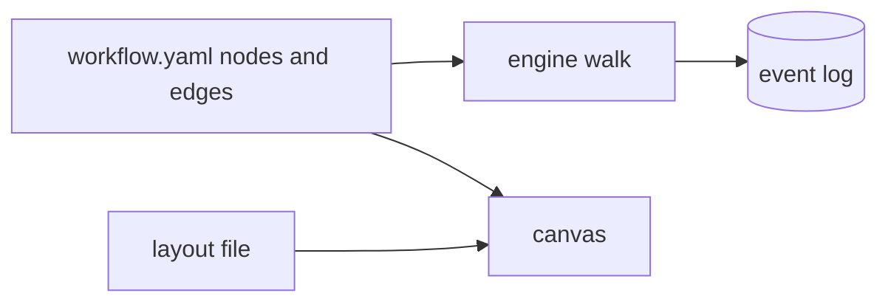

# Node workflows (overview and decisions)

A workflow becomes a graph of a few node kinds that are easy to read on
first visit and easy to extend: Trigger, Prompt, Asset, Agent, Command,
LLM, Judge, Approval and Output. Wires carry text or files; a Judge
picks a yes or no path; back edges make loops. The idea comes from
OpenBot's Workflows page (nightly-labs/openbot at `a3ccccd`). We copy
ideas and behavior only, never code: OpenBot is PolyForm Noncommercial.

The event log, `workflow.yaml` as the source of truth, comment-keeping
writes, the sandbox and trust checks, connections and the library stay.

## Doc map

| Doc     | Holds                                                         |
| ------- | ------------------------------------------------------------- |
| DES-031 | this overview: decisions, goals, what changes, open questions |
| DES-032 | node catalog: each kind, its settings, ports, run and UI      |
| DES-033 | workflow file, node files and the layout file                 |
| DES-034 | engine: events, walk, loops, judge, approval, data, recovery  |
| DES-035 | node kind registry and how to add a kind                      |
| DES-036 | canvas editor and run view, tied to the DES-027 spec sheet    |
| DES-037 | delivery: slices, verification, risks                         |

Backlogs BL-074 to BL-104 hold the work, one small verifiable change
each; DES-037 has the build order.

## Decisions (pootato, 2026-11-22)

| No. | Decision                                                       | Where    |
| --- | -------------------------------------------------------------- | -------- |
| 1   | An LLM node exists and runs through a CLI; no API tokens       | DES-032  |
| 2   | Loops are back edges, as in OpenBot                            | DES-034  |
| 3   | Approval is a node; the per-task `approval: true` flag goes    | DES-032  |
| 4   | A Trigger node starts runs                                     | DES-032  |
| 5   | Output is a node kind; a workflow may have several             | DES-032  |
| 6   | A Prompt node holds shared text for later nodes                | DES-032  |
| 7   | A dedicated Judge node: instructions, model, effort, yes or no | DES-032  |
| 8   | Spawned steps are removed entirely                             | DES-034  |
| 9   | Node positions are saved, as in OpenBot                        | DES-033  |
| 10  | One format, replaced in place; old workflows deleted by hand   | DES-033  |
| 11  | An Asset node points at library resources (repos, pages, more) | DES-032  |
| 12  | No decorative nodes now (drawing, note, shape, text); later    | this doc |
| 13  | Named answers with `{{name}}`, as in OpenBot                   | DES-032  |

## Goals

- First visit makes sense without docs: an empty canvas that teaches,
  one Add node menu, settings on the node, results on the node.
- Few kinds, many variants: new behavior is mostly a new variant (an
  output target, an asset source), and a new kind is three files
  (DES-035).
- Same safety as today: every CLI step runs in its attempt sandbox
  under the trust checks (DES-006, DES-019); nothing leaves the machine
  except through an Output node under the connection policy (DES-026).
- Same reliability as today: append, then act; resume by replay.

## Non-goals (for now)

| Out of scope                                  | Why                                               |
| --------------------------------------------- | ------------------------------------------------- |
| Decorative nodes (note, text, shape, drawing) | pootato: later; no step reads them                |
| Trigger types beyond manual and work item     | DES-014 non-goal; open question 1                 |
| Agents as long-lived conversations            | flows keeps one stateless CLI process per attempt |
| Model API keys                                | sign-in stays CLI-owned (DES-016); LLM uses a CLI |
| Runtime spawn or a `matrix` key               | removed by decision 8                             |
| Migrating old workflows or replaying old runs | decision 10                                       |
| Copying OpenBot code, strings or styles       | license; flows keeps shadcn base-nova (DES-027)   |

## What changes

| Area       | Before                                               | After                                                    |
| ---------- | ---------------------------------------------------- | -------------------------------------------------------- |
| File       | `tasks:` with `needs`, `when`, `repeat`, `approval`  | `nodes:` and `edges:` with ports and branches (DES-033)  |
| Kinds      | command, agent, publish                              | nine kinds from one registry (DES-032, DES-035)          |
| Conditions | `when`, branch `needs`, `repeat until`, agent judges | Judge node with yes and no ports                         |
| Loops      | `repeat` on one task                                 | back edges with a loop limit (DES-034)                   |
| Approval   | `approval: true` on a task                           | Approval node; Reject stops the run                      |
| Library    | task `uses` and work item links                      | Asset node wired to steps; work item links stay          |
| Publish    | `kind: publish` task                                 | Output node with target `publish`                        |
| Run inputs | top-level `inputs:`                                  | settings of the Trigger node                             |
| Spawn      | agents add tasks at run time                         | removed                                                  |
| Layout     | automatic, never saved                               | saved per node in a layout file; automatic for new nodes |
| Editor     | locked graph plus side settings                      | canvas first, settings on the node, Sheet for the rest   |

## Kept on purpose

- Event log as the engine core (DES-003): new and renamed event types
  only (DES-034).
- YAML as the source of truth, edited by canvas, YAML pane or hand,
  with comments and key order kept (DES-013).
- One stateless CLI process per attempt, sandboxed (DES-005, DES-006),
  with model and effort resolution (DES-023) and timeouts (DES-019).
- Work items, connections, library pins, work copies, publish policy
  and the effects ledger (DES-026).
- Nested concurrency limits and `maxConcurrentRuns` with a queue
  (DES-003, DES-021). OpenBot ignores a trigger while a run is open;
  flows keeps its queue.

## Superseded in part

| Doc     | Part that changes                                               |
| ------- | --------------------------------------------------------------- |
| DES-002 | rewritten in place; points to DES-033 for the format            |
| DES-003 | task lifecycle and event kinds; replaced by DES-034             |
| DES-004 | conditions, branch edges, `repeat`; replaced by Judge and loops |
| DES-005 | spawn and fan-out; removed. Stateless CLI rules stay            |
| DES-007 | "positions are not saved" ledger entry is reversed              |
| DES-010 | graph rules, layout, no pinning; replaced by DES-036            |
| DES-013 | PUT shape and task-id diff; extended for nodes and layout       |
| DES-014 | "Saved node positions" non-goal is dropped                      |
| DES-020 | `tasks/<id>/` and judge slots; replaced by `nodes/<id>/`        |
| DES-026 | `uses` and publish tasks; replaced by Asset and Output nodes    |
| DES-028 | Editor, Task Sheet; replaced by DES-036                         |
| DES-029 | Run view task table and graph; extended for node steps          |

Each of these docs carries a note that points here.

## Relation to the skills and rules draft

The skills and rules draft (worktree `flows-des-025`, branch
`docs/des-025-skills-rules`, not merged) uses ids that are taken on
`develop` (DES-025, BL-031 to BL-034). It must be renumbered after this
plan (DES-038 and BL-105 onward). Its library of skill and rule sources
fits as Asset sources or as Agent node settings, and its examples use
`tasks:` and spawn, which this plan removes (open question 6).

## Open questions for pootato

1. Which trigger types are in scope? Manual (with or without a work
   item) is planned. Schedule, webhook and chat triggers are a DES-014
   non-goal today. Should any of them come in, and when?
2. Do you want the Command node? OpenBot has no shell step, but flows
   runs scripts today. The plan keeps it.
3. Judge check mode: OpenBot's condition can also test a named answer
   with no model call (`risk = high`). Keep both modes, or the model
   judge only?
4. Output targets for the first slice: run output folder, publish
   through a connection, in-app notify. Any others?
5. Approval Reject: OpenBot stops the whole run. The plan follows
   that. Do you also want a "reject, take the No path" option?
6. Skills and rules: an Asset source wired into an Agent, or settings
   on the Agent node, as the draft has it?
7. Loop limit: the plan adds one (default 5 passes per loop) because
   OpenBot has none. Is 5 a good default?
8. A failed node: the plan follows OpenBot, so open steps on other
   branches finish and the run then ends failed. Is that right, or
   should the run stop at once?
