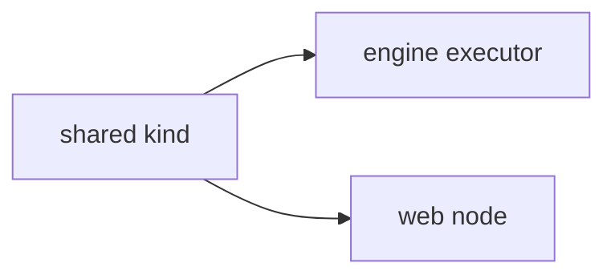

# Node kind registry

pootato likes that OpenBot has few node kinds yet feels dynamic and
extensible. Studying its code shows why, and also where it is not as
easy as it looks.

## Why OpenBot feels extensible

| Trait                                 | Where in OpenBot (`a3ccccd`)                                                                     |
| ------------------------------------- | ------------------------------------------------------------------------------------------------ |
| Few kinds, many variants              | `WORKFLOW_TRIGGER_TYPES`, `WORKFLOW_OUTPUT_TARGETS` in `packages/contracts/src/ipc-workflows.ts` |
| One wiring table                      | `WORKFLOW_PORTS` and `workflowEdgeProblem` in the same file                                      |
| A loose settings bag per node         | `WorkflowFields`; `WORKFLOW_RUNTIME_FIELDS` lists what counts as a change                        |
| One node frame for all kinds          | `NodeShell` in `packages/ui/src/features/workflows/workflow-node-parts.tsx`                      |
| Answers and templates flow downstream | `fillWorkflowTemplate`, check operators in `ipc-workflow-answers.ts`                             |

It is not a plugin system: a new kind touches about 11 to 14 files
(contracts, the SQL kind list in `migrations/0046-workflows.ts`, the
`execute` switch in `src/backend/workflows/workflows.ts`, the walk and
agent tools, a new node component, the `CanvasNodeView` switch, the
Add menu, node parts, search fields and UI strings).

## Design for flows

Three registries, one per layer, with the same kind keys. No switch on
kind outside them.

### Shared: `packages/shared/src/nodes/`

One file per kind exports `defineNodeKind({...})`:

| Field      | Meaning                                                                  |
| ---------- | ------------------------------------------------------------------------ |
| `kind`     | key used in YAML                                                         |
| `group`    | `inputs`, `steps` or `flow` (Add node menu)                              |
| `ports`    | `{ in: [...], out: [...] }`, or `branches: [yes, no]` for Judge          |
| `settings` | a zod object for the kind's YAML keys                                    |
| `files`    | fixed node files (`prompt.md`, `rule.md`, ...) and which are required    |
| `process`  | `none`, `cli` or `shell`; decides limits and trust checks                |
| `answers`  | whether the kind may declare named answers                               |
| `variants` | optional sub-registry key (asset sources, output targets, trigger types) |

`index.ts` lists the kinds. `workflowSchema` builds the `nodes` union
from that list, and the port table and validation read the same list,
so the YAML schema, the editor and the engine cannot disagree.

### Engine: `packages/engine/src/nodes/`

One file per kind exports `defineExecutor({ kind, run })`. `run`
receives a context (frozen graph, step, inputs, pins, paths, append)
and either settles the step at once (no process) or returns a launch
spec that the existing `launchTaskAttempt` path starts in the sandbox.
`runner.ts` loses its kind branches (today it throws on an unknown
kind) and looks the executor up.

### Web: `apps/web/src/nodes/`

One file per kind exports `defineNodeView({ kind, icon, Body, Sheet })`.
`Body` is what sits on the canvas card inside the shared `NodeFrame`
(ports, status, timer, result, Run step, Retry). `Sheet` holds the
settings that do not fit on the card. The Add node menu and the React
Flow `nodeTypes` come from the list.

### Variants

Asset sources, output targets and trigger types are sub-registries:

- Asset sources build on the connectors registry
  (`packages/engine/src/connectors/`, DES-026): each connector already
  lists its entity kinds; an Asset picker lists them.
- Output targets: `folder`, `publish`, `notify` first.
- Trigger types: `manual` first (DES-031 open question 1).

## Adding a kind

| Step | File                                        |
| ---- | ------------------------------------------- |
| 1    | `packages/shared/src/nodes/<kind>.ts`       |
| 2    | `packages/engine/src/nodes/<kind>.ts`       |
| 3    | `apps/web/src/nodes/<kind>.tsx`             |
| 4    | one line in each of the three `index.ts`    |
| 5    | a row in DES-032 and a DES-016 decision row |

A registry test fails when a shared kind has no executor or no view,
or when a view or executor names a kind that shared does not list.
There is no database change, because nodes live in YAML.

Adding a variant is one file in its sub-registry plus its settings
schema.

## Guards

- Kind keys are lowercase words, unique, never reused.
- A kind's settings schema is strict: unknown keys are errors, so a
  typo in YAML shows at once (as the docs frontmatter does).
- `process: cli` kinds join the trust preflight automatically: the
  Start dialog lists every CLI that agent, LLM and rule Judge nodes
  use (DES-019, BL-064).
