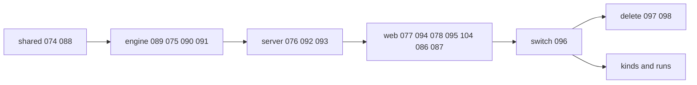

# Node workflows delivery, verification and risks

Every backlog is one focused change a reviewer can read, mostly in one
layer, with a named test. After each one merges, `develop` is green and
the app works as before for anyone not testing the new path.

## Rollout

The format is replaced in place (DES-031 decision 10), but not in one
big change. The node path is built next to the task path, switched on
in one small step, and the task path is then deleted:

1. Additive: shared and engine modules nothing calls yet.
2. Behind a flag: server routes and web screens for nodes run only when
   the server starts with `FLOWS_NODES=1`. With it off, the app is
   today's app, and today's tests and e2e specs pass unchanged.
3. Switch (BL-096): the flag defaults on; e2e moves to nodes. Only
   config and tests change.
4. Delete (BL-097, BL-098): the task UI, then the task engine path,
   spawn, old conditions, task events and the flag itself.

The flag is temporary and never user facing; after BL-098 there is one
format and no second path. New kinds land after the switch, one per
backlog, on the node path only.

## Build order

| Step | Backlog | Layer         | Depends on     | Proven by                                                   |
| ---- | ------- | ------------- | -------------- | ----------------------------------------------------------- |
| 1    | BL-074  | shared        | none           | `nodes.test.ts`: sample parses, bad edges and old keys fail |
| 2    | BL-088  | shared        | BL-074         | `yaml-edit.test.ts`: comments and key order kept            |
| 3    | BL-089  | shared engine | BL-074         | `fold-steps.test.ts`: each step event folds                 |
| 4    | BL-075  | engine        | BL-089         | `walk.test.ts`: chain, join, skip, branch tables            |
| 5    | BL-090  | engine        | BL-075         | `tick.test.ts`: no-process run and crash rerun              |
| 6    | BL-091  | engine        | BL-090         | `process-kinds.test.ts`: env, retry, limits, resume         |
| 7    | BL-076  | server        | BL-074, BL-088 | `node-workflow-files.test.ts`: PUT, trash, rename           |
| 8    | BL-092  | server        | BL-076         | `layout-routes.test.ts`: orphans, YAML hash unchanged       |
| 9    | BL-093  | server        | BL-091, BL-092 | `node-runs.test.ts`: start, cancel, retry, websocket        |
| 10   | BL-065  | web           | done BLs       | frame e2e, as written                                       |
| 11   | BL-077  | web           | BL-065, BL-092 | `node-canvas.spec.ts`: drag, reload, same place             |
| 12   | BL-094  | web           | BL-077         | `node-add.spec.ts`: build three nodes from empty            |
| 13   | BL-078  | web           | BL-094         | `node-cards.spec.ts`: edit on card, file written            |
| 14   | BL-095  | web           | BL-078         | `node-sheet.spec.ts`: timeout, input, delete                |
| 15   | BL-104  | web           | BL-093, BL-095 | `node-start.spec.ts`: input reaches `RUN_INPUT`             |
| 16   | BL-086  | web           | BL-093, BL-078 | `node-run.spec.ts`: nodes go done, Retry on fail            |
| 17   | BL-087  | web           | BL-093, BL-078 | `node-run-view.spec.ts`: step rows, failed preselected      |
| 18   | BL-096  | config, tests | 086, 087, 104  | full test and e2e with the flag on                          |
| 19   | BL-097  | web           | BL-096         | tests green, task UI gone                                   |
| 20   | BL-098  | all           | BL-097         | tests green, no task events or flag left                    |
| 21   | BL-102  | engine web    | BL-096         | `partial-runs.test.ts` and `node-run-step.spec.ts`          |
| 22   | BL-103  | web           | BL-096         | `node-run-history.spec.ts`                                  |
| 23   | BL-079  | one kind      | BL-096         | `judge.test.ts` and `node-judge.spec.ts`                    |
| 24   | BL-080  | one kind      | BL-096         | `approval.test.ts` and `node-approval.spec.ts`              |
| 25   | BL-081  | engine web    | BL-079         | `walk-loops.test.ts`                                        |
| 26   | BL-083  | one kind      | BL-096         | `llm.test.ts`, opt-in live test                             |
| 27   | BL-082  | one kind      | BL-096         | `asset.test.ts` with the fake connector                     |
| 28   | BL-099  | web           | BL-082         | `node-asset.spec.ts`                                        |
| 29   | BL-084  | one target    | BL-082         | `output-publish.test.ts` with publish fixtures              |
| 30   | BL-100  | new notices   | BL-096         | `notices.test.ts` and `node-notify.spec.ts`                 |
| 31   | BL-085  | answers       | BL-083         | `answers.test.ts` in shared and engine                      |
| 32   | BL-101  | one mode      | BL-085, BL-079 | `judge-check.test.ts`                                       |

Steps 1 to 9 can be reviewed without the app changing at all. Steps 21
to 32 are independent of each other except where a dependency is
listed, so they can go in any order the product needs. BL-067 (amended)
and BL-068 to BL-071 are unaffected and can land any time.

## Verification

- Each backlog names its test file. Engine tests use a stub CLI on
  `PATH`, as `packages/engine/src/agents-run.test.ts` does today.
- e2e runs with a temporary `FLOWAPP_HOME`, never the user's data.
  Until BL-079 the e2e graphs use Command nodes, because the e2e app
  has no CLI stub; BL-079 adds one.
- UI backlogs ship a Playwright video plus light and dark screenshots,
  and refresh the BL-061 layout baselines in the same change.
- The registry test (DES-035) grows with each layer: shared and engine
  in BL-090, all three in BL-078.
- Live checks with real CLIs stay opt-in, as today's live trust test.
- Every backlog: `pnpm lint`, `pnpm typecheck`, `pnpm test`,
  `pnpm test:e2e` and `pnpm docs:check` pass, with the flag off before
  BL-096 and on after it.

## Risks and guards

| Risk                                           | Guard                                                                   |
| ---------------------------------------------- | ----------------------------------------------------------------------- |
| Two paths drift while both exist               | flag window is short: steps 7 to 18; the task path gets no new features |
| The switch breaks a screen nobody tested       | BL-104 moves Start and Overview first; BL-096 runs every e2e on nodes   |
| Back-edge loops run forever or rerun too much  | `loopPasses` limit; cache keyed by pass and input; walk table tests     |
| A crash leaves a no-process step half done     | `step_started` before acting; no-process kinds repeat safely on resume  |
| Judge answers are unclear or drift             | first-word parse, unclear fails; the rule file shows in the step detail |
| Layout file and YAML disagree                  | key by node id; dagre for missing; drop orphans; rename moves the entry |
| Downstream steps lose upstream paths at gates  | Judge and Approval forward inputs; a data passing test per kind         |
| Kind switches creep back outside the registry  | lint rule against `kind ===` outside registries; completeness test      |
| Scope grows toward OpenBot's triggers and apps | DES-031 non-goals; trigger types stay an open question                  |
| Copying OpenBot code or text by accident       | ideas only; reviews check for copied strings and structure              |

## Done when (this plan)

- [ ] DES-031 to DES-037 and BL-074 to BL-104 are on `develop`.
- [ ] Reversed docs carry a note pointing to DES-031.
- [ ] Open questions in DES-031 have answers or are marked later.
