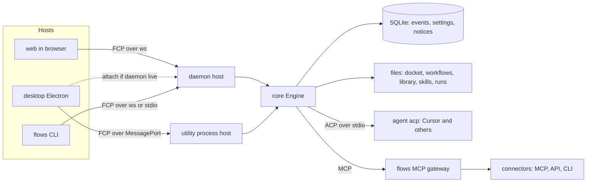
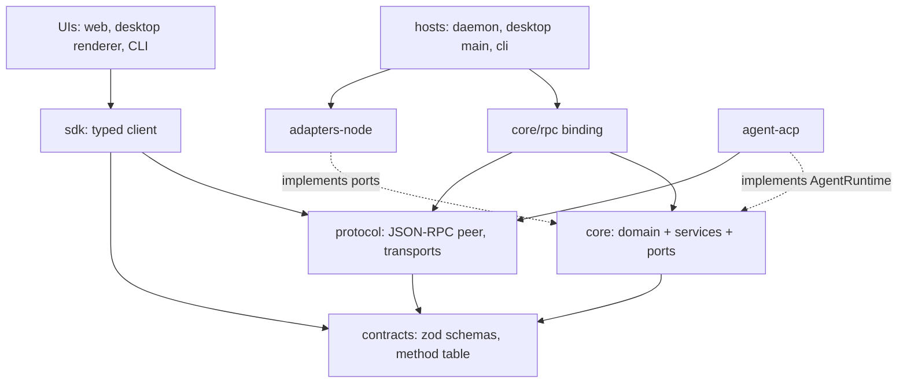
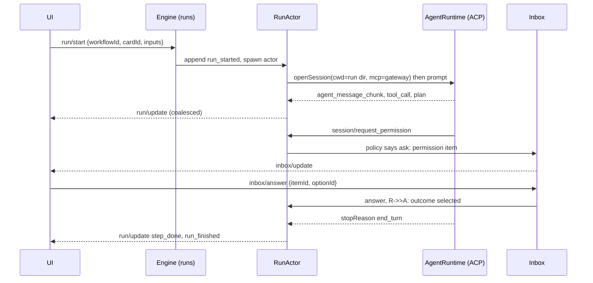

# System architecture v2

The mockups under `apps/web/src/pages/mock/` define the next product:
**Docket** (cards), **Workflows** (node chains), **Inbox** (things that
need a person), **Files**, **Library**, **Skills** and **Connectors**.
This doc is the target shape of the system that serves them. The engine is
a library with no UI or transport knowledge; every UI (web today, Electron
next, a CLI later) talks to it through one protocol.

Companion docs: protocol [DES-040](des-040-flows-client-protocol.md),
engine internals and the ACP agent runtime
[DES-041](des-041-engine-core.md), patterns and coding standards
[DES-042](des-042-engine-patterns-standards.md).

## Decisions

1. **Engine = library + protocol.** `packages/core` exposes a typed
   `Engine` facade. A protocol binding (DES-040) serves it over any
   transport: WebSocket for the browser, a `MessagePort` for Electron,
   stdio for a CLI or tests. Same methods, same types everywhere.
2. **ACP-first agents.** All agent CLIs sit behind one `AgentRuntime`
   port. The first adapter speaks the Agent Client Protocol to
   Cursor (`agent acp`); any ACP agent plugs in with a profile. Non-ACP
   CLIs keep a spawn adapter.
3. **New core, migrated in place.** Keep the proven parts (SQLite event
   log, files as the model, append-then-act, hash-checked writes) and move
   today's `packages/engine` behind ports module by module (strangler).
4. **One JSON-RPC library twice.** The same JSON-RPC peer powers our
   protocol (UI to engine) and ACP (engine to agent). One framing, one
   cancellation model, one test harness.
5. **One engine per `FLOWAPP_HOME`.** A lock file names the live owner;
   every other host attaches as a client. No two writers of one home.

## System context

FCP is the Flows Client Protocol (DES-040). Everything stays on one Mac,
bound to `127.0.0.1`.

## Layers

Hexagonal (ports and adapters). Dependencies point inward only.

| Layer     | Knows about                                    | Never knows about               |
| --------- | ---------------------------------------------- | ------------------------------- |
| contracts | data shapes, method names, error codes         | Node, DOM, React, SQLite        |
| protocol  | JSON-RPC 2.0, framing, cancellation, peers     | domain rules                    |
| core      | domain, use cases, ports, run engine           | transports, `node:` modules, UI |
| adapters  | one port each: SQLite, fs, processes, keychain | other adapters, UI              |
| agent-acp | ACP, agent profiles (Cursor)                   | Docket, Library, UI             |
| hosts     | composition root, lifecycle, lock, transport   | domain rules                    |
| sdk       | typed calls and subscriptions over a peer      | engine internals                |
| UIs       | screens, client state, sdk                     | files, SQLite, processes        |

## Packages (target)

| Package                  | Owns                                                                                          | May import                                  |
| ------------------------ | --------------------------------------------------------------------------------------------- | ------------------------------------------- |
| `packages/contracts`     | zod schemas, branded ids, FCP method table, error codes (was `shared`)                        | nothing in the repo                         |
| `packages/protocol`      | JSON-RPC peer, `Transport` interface, ndjson/ws/MessagePort framings                          | `contracts`                                 |
| `packages/core`          | bounded contexts, services, ports, run engine, node registry, `createEngine`, `bindEngine`    | `contracts`, `protocol` (types)             |
| `packages/adapters-node` | SQLite event store, fs document store, watcher, process runner, sandbox, keychain, blob store | `core`, `contracts`                         |
| `packages/agent-acp`     | `AgentRuntime` over ACP; `cursor` and `generic` profiles                                      | `core` (ports), `protocol`, `contracts`     |
| `packages/mcp-gateway`   | local MCP server that exposes allowed connector capabilities to agents                        | `core` (ports), `contracts`                 |
| `packages/sdk`           | `FlowsClient`, typed call/subscribe, reconnect and resync                                     | `protocol`, `contracts`                     |
| `packages/sdk-react`     | `useQuery`/`useSubscription` hooks over `sdk`                                                 | `sdk`, React                                |
| `packages/ui`            | unchanged: shadcn and domain-free AI Elements                                                 | nothing in the repo                         |
| `apps/daemon`            | today's `apps/server`: composition root, ws + blob HTTP, lock file                            | all of the above except UI                  |
| `apps/web`               | screens from the mockups; talks only through `sdk-react`                                      | `sdk-react`, `sdk`, `ui`, `contracts`       |
| `apps/desktop`           | Electron main, preload, utility-process host, host capabilities                               | `core`, `adapters-node`, `agent-acp`, `sdk` |
| `apps/cli`               | `flows` command: run a workflow, list inbox, attach                                           | `sdk`, `protocol`                           |

`core` must stay free of `node:` imports so it can run in a utility
process, a worker or tests with in-memory adapters. Enforced by lint
(DES-042).

## Bounded contexts (from the mockups)

| Context    | Mockup                                              | Aggregate root     | Source of truth                                      |
| ---------- | --------------------------------------------------- | ------------------ | ---------------------------------------------------- |
| Docket     | `DocketPage`, `CardPanel`, `ColumnsDialog`          | `Card`, `Board`    | `docket/` files (DES-038)                            |
| Workflows  | `WorkflowsMockPage`, `WorkflowEditorMock`           | `Workflow` (graph) | `workflows/<id>/workflow.yaml`                       |
| Runs       | `RunBar`, `CardRunsSection`, `RunWorkflowDialog`    | `Run`              | SQLite event log, `runs/<id>/` files                 |
| Inbox      | `InboxPage`                                         | `InboxItem` (view) | projection over run events                           |
| Library    | `LibraryPage`, `LibraryVersions`, `ProvidersDialog` | `LibItem`          | `library/<id>/v<n>/` + `item.yaml`                   |
| Connectors | `ConnectorsPage`, `ConnectorSheet`                  | `Connector`        | `connectors/<id>.yaml` + keychain                    |
| Skills     | `SkillsPage`, `SkillSources`                        | `Skill`            | `SKILL.md` folders (`.agents`, `.claude`, `.cursor`) |
| Files      | `FilesPage`, `FilesTree`, `FilePreview`             | none (read model)  | workspace folders                                    |

Contexts talk through the engine's domain event bus, never by reaching
into another context's store. Examples: `run.finished` lets Docket add a
`flows-run` ref; `library.item_pulled` refreshes card refs that point at
it; `connector.status_changed` posts an Inbox item for an expired sign-in.

## Runtime topologies

| Topology           | Engine runs in                    | UI connects by                          |
| ------------------ | --------------------------------- | --------------------------------------- |
| Dev / web          | `apps/daemon` (tsx, Node)         | browser ws `127.0.0.1:8787/fcp` + token |
| Desktop standalone | Electron `utilityProcess`         | renderer `MessagePort` via preload      |
| Desktop + daemon   | daemon (found by lock file)       | renderer ws, same as web                |
| CLI                | daemon, or in-process for one run | ws, or stdio to `flows engine --stdio`  |
| Tests              | in-process, in-memory adapters    | `createLinkedTransports()` pair         |

**Ownership.** On start a host takes `$FLOWAPP_HOME/engine.lock`
(`O_EXCL`, holds pid, transport URL and a per-launch token, mode 0600). A
host that finds a live owner attaches as a client; a stale lock (pid gone)
is taken over. This keeps the "one writer" rule of the event log.

## Data flow: run a workflow on a card

## What stays, what changes

| Today                                        | v2                                                               |
| -------------------------------------------- | ---------------------------------------------------------------- |
| Hono REST + `hc` typed client, ws snapshots  | FCP JSON-RPC; HTTP only for blob download/upload                 |
| `packages/engine` imports `node:` everywhere | `core` behind ports; Node code in `adapters-node`                |
| `cli-adapters.ts` builds shell strings       | `AgentRuntime` port; ACP sessions with streamed events           |
| Agent approvals are not visible mid-step     | ACP permission requests become Inbox items under a policy        |
| Work items record (DES-026)                  | Docket cards as files (DES-038)                                  |
| Connections tied to library pull             | Connectors (transport x auth x capabilities) via the MCP gateway |
| UI types from `AppType`                      | UI types from `contracts`; sdk is the only door                  |

Kept: SQLite append-only event log and fold, files as context,
hash-checked writes with 409 semantics (now error `conflict`), node
registry (DES-035), sandbox, local-only binding.

## Migration (strangler, each step shippable)

| Step | Change                                                                     | Verify                                |
| ---- | -------------------------------------------------------------------------- | ------------------------------------- |
| M1   | Add `protocol` and `contracts` (rename of `shared` with re-export shim)    | unit tests, `pnpm typecheck`          |
| M2   | Daemon serves FCP on `/fcp` next to REST; `bindEngine` over current engine | protocol contract tests               |
| M3   | Extract ports; move SQLite, fs, process code to `adapters-node`            | port contract suites on fake and real |
| M4   | `agent-acp` with Cursor profile behind setting `agents.runtime=acp`        | e2e with a fake ACP agent             |
| M5   | Docket, Inbox, Library, Connectors, Skills services per mockups            | e2e per page                          |
| M6   | Web moves from `hc` to `sdk-react`; REST routes removed except blobs       | e2e green, no `hc` import (lint)      |
| M7   | `apps/desktop` (utility-process host, attach mode)                         | Playwright Electron smoke             |

Each step lands as backlog items (BL) with "Done when" lists; the DES-017
roadmap gets a v2 phase when M1 starts.

## Risks

| Risk                                             | Guard                                                                                |
| ------------------------------------------------ | ------------------------------------------------------------------------------------ |
| Two protocols to keep in sync during M2 to M6    | REST handlers call the same services; delete per page as it moves                    |
| Cursor ACP gaps (MCP param, model switch)        | profile capability flags; fall back to launch flags and `.cursor/mcp.json` (DES-041) |
| Engine in Electron and daemon racing on one home | `engine.lock`; attach instead of start                                               |
| Over-abstraction                                 | a port exists only with two implementations (real + fake)                            |
| Chatty streams (token chunks) flooding the UI    | coalesce per run per 50 ms; chunks also land in log files                            |

## Open questions

1. Rename `apps/server` to `apps/daemon` in M2 or at the end (M6)?
2. Does Electron ship its own Node agent CLIs, or require them on `PATH`?
3. Multi-workspace (several `FLOWAPP_HOME`s in one desktop window): out of
   scope for v2, or a `workspace/*` namespace now?
