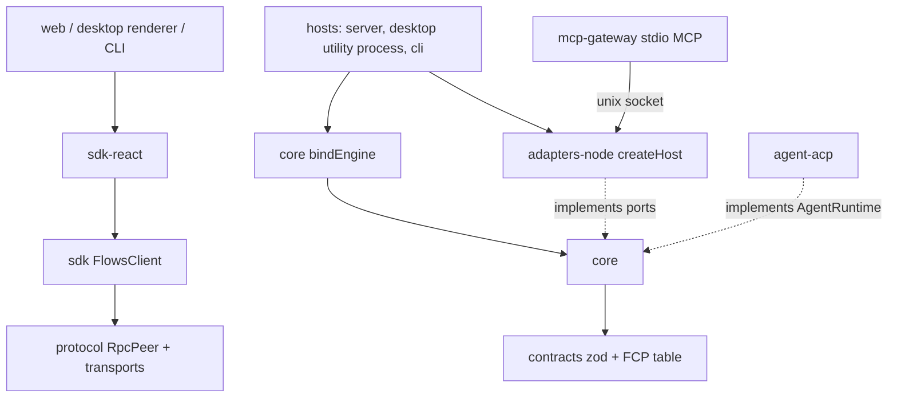
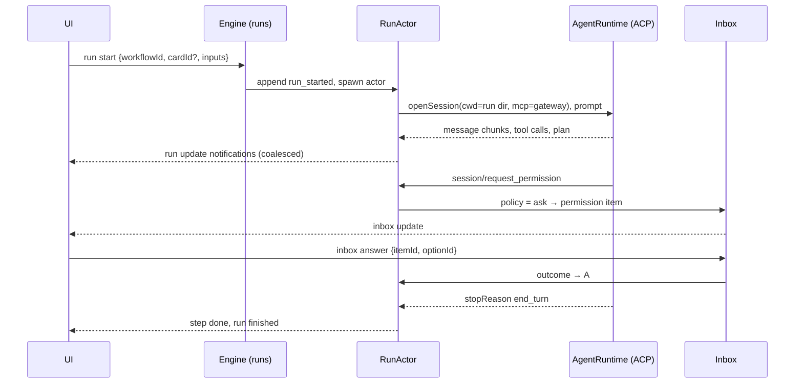

# Architecture overview

Flows is a local-only app for building and running workflows of tasks.
A task is a command, a script or an AI agent CLI, and each one runs as its
own process. The engine is a UI-free library. Every UI reaches it through
one JSON-RPC 2.0 protocol, the **Flows Client Protocol (FCP)**.
Everything runs on one Mac and binds only to `127.0.0.1`.

## Product areas (bounded contexts)

| Context    | Route                          | Aggregate                   | Source of truth                                                     |
| ---------- | ------------------------------ | --------------------------- | ------------------------------------------------------------------- |
| Docket     | `/docket` (home)               | `Card`, `Board`             | `docket/` plain files                                               |
| Workflows  | `/workflows`, `/workflows/:id` | `Workflow` (node graph)     | `workflows/<id>/workflow.yaml` (+ node files, layout file)          |
| Runs       | inside workflows and cards     | `Run`                       | SQLite event log, `runs/<id>/` files                                |
| Inbox      | `/inbox`                       | `InboxItem` (projection)    | folded from run events: approval, permission, question, plan_review |
| Library    | `/library`                     | `LibItem` (`v<n>` versions) | `library/<id>/v<n>/` + `item.yaml`                                  |
| Connectors | `/connectors`                  | `Connector`                 | `connectors/<id>.yaml` + secrets                                    |
| Skills     | `/skills`                      | `Skill`                     | `SKILL.md` folders (`.agents`, `.claude`, `.cursor`)                |
| Files      | `/files`                       | read model                  | workspace folders                                                   |
| Settings   | sidebar panel                  | settings                    | SQLite `settings` table                                             |

Contexts talk through the engine's domain events, never through another
context's store.

## Layers (hexagonal)

| Layer                                                     | Package(s)         | Spec                                                                               |
| --------------------------------------------------------- | ------------------ | ---------------------------------------------------------------------------------- |
| Data shapes, ids, FCP method table, events                | `contracts`        | [packages/contracts.md](packages/contracts.md)                                     |
| JSON-RPC peer and transports                              | `protocol`         | [packages/protocol.md](packages/protocol.md)                                       |
| Domain, ports, run engine, node kinds, inbox, FCP binding | `core`             | [packages/core.md](packages/core.md)                                               |
| Node I/O adapters and host composition                    | `adapters-node`    | [packages/adapters-node.md](packages/adapters-node.md)                             |
| Agent runtime over ACP (Cursor, generic)                  | `agent-acp`        | [packages/agent-acp.md](packages/agent-acp.md)                                     |
| MCP server that agents call, forwarded to engine          | `mcp-gateway`      | [packages/mcp-gateway.md](packages/mcp-gateway.md)                                 |
| Typed client, reconnect, resync                           | `sdk`, `sdk-react` | [packages/sdk.md](packages/sdk.md), [packages/sdk-react.md](packages/sdk-react.md) |
| Components and theme                                      | `ui`               | [packages/ui.md](packages/ui.md), [design-system.md](design-system.md)             |
| HTTP + WS host                                            | `apps/server`      | [apps/server.md](apps/server.md)                                                   |
| UI                                                        | `apps/web`         | [apps/web.md](apps/web.md)                                                         |
| Electron shell                                            | `apps/desktop`     | [apps/desktop.md](apps/desktop.md)                                                 |
| Command line                                              | `apps/cli`         | [apps/cli.md](apps/cli.md)                                                         |
| End-to-end tests                                          | `apps/e2e`         | [apps/e2e.md](apps/e2e.md)                                                         |
| Docs tooling                                              | `docs-tools`       | [packages/docs-tools.md](packages/docs-tools.md)                                   |

## Runtime topologies

| Topology                 | Engine runs in                           | UI connects by                                                                                                                       |
| ------------------------ | ---------------------------------------- | ------------------------------------------------------------------------------------------------------------------------------------ |
| Dev / web                | `apps/server` (tsx) on `127.0.0.1:8787`  | browser fetches `GET /fcp/bootstrap`, then opens a WS to `/fcp` with the token; Vite on `127.0.0.1:5173` proxies `/fcp` and `/blobs` |
| Desktop standalone       | Electron `utilityProcess`                | renderer `MessagePort` handed over by preload `connect()`                                                                            |
| Desktop + running server | the server (found through `engine.lock`) | WS, same as web                                                                                                                      |
| CLI                      | the server, or in-process                | WS, or ndjson stdio (`flows engine --stdio`), or linked in-memory                                                                    |
| Tests                    | in-process with in-memory fakes          | `createLinkedTransports()`                                                                                                           |

**One engine per `FLOWAPP_HOME`.** A host takes `$FLOWAPP_HOME/engine.lock`
(exclusive create, mode 0600, holds pid, transport URL and a per-launch
token). A host that finds a live owner attaches as a client. A stale lock
(dead pid) is taken over.

## Core invariants

1. **Append, then act.** Run state is only a fold over the SQLite `events`
   table. Write the event first, then do the side effect. Attempt ids are
   written before launch, so a crash cannot cause duplicates.
2. **Resume.** On start, replay the log. Live pids re-attach; otherwise
   the step becomes `interrupted` and its retry policy applies.
3. **Files are the model.** Workflows, cards, library items and connectors
   are plain files. Writes check a hash, and YAML edits keep comments.
4. **Isolation.** Each task attempt runs in its own process group under
   `sandbox-exec` (writes limited to the workflow dir), with a timeout.
   Without a sandbox it runs with a warning.
5. **Agents.** Agent nodes open ACP sessions (`agent acp`) whose cwd is
   the run dir and whose MCP server is the Flows gateway. An ACP
   `session/request_permission` goes through the permission policy and
   may become an Inbox item. The answer flows back to the agent.

## Run a workflow end to end

Exact method names, params and event payloads are in
[contracts](packages/contracts.md) and [core](packages/core.md).

## Failure handling

| Failure                        | Recovery                                                               |
| ------------------------------ | ---------------------------------------------------------------------- |
| Engine restarts mid-run        | replay the log; re-attach live pids, else `interrupted` + retry policy |
| Crash between event and action | append-then-act + pre-written attempt ids                              |
| Task hangs                     | timeout kills the process group; retry policy applies                  |
| Sandbox unavailable            | run unrestricted with a warning badge                                  |
| WS drops                       | sdk backs off, reconnects and resyncs; UI marks data stale             |
| Invalid `workflow.yaml`        | diagnostics on fields and in YAML; the last valid graph is kept        |

Design history and rationale live in `docs/designs/` (DES-014…DES-044).
This spec describes the code as of commit `645eaa8` on `develop`.
