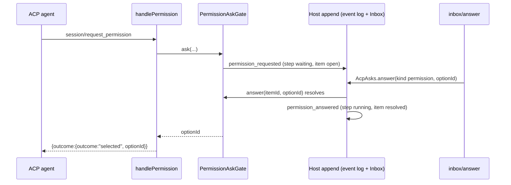

# core: agents (permission chain, ACP ask gates) and MCP gateway

Part of the [`@workspace/core` spec](core.md). Covers `src/agents/` and
`src/gateway/`.

An agent step (llm / agent / condition kinds, see
[core-nodes.md](core-nodes.md)) opens an ACP session through
`AgentRuntime.open`. ACP client requests that need a person
(`session/request_permission`, `cursor/ask_question`, `cursor/create_plan`)
reach core through `SessionSpec.handle*` callbacks built by
`acpSessionHandlers`. Each handler first applies policy, and otherwise
**parks** the request in a gate: the gate appends a `*_requested` /
`question_asked` event (which the Inbox projection turns into an item, see
[core-inbox.md](core-inbox.md)) and returns a promise resolved by
`inbox/answer`, `inbox/dismiss` or a timer. The live ACP session holds the
JSON-RPC request open the whole time; the run actor only sees the events.

## Files

| File                             | Purpose                                                              |
| -------------------------------- | -------------------------------------------------------------------- |
| `agents/index.ts`                | barrel (all names below)                                             |
| `agents/permission-policy.ts`    | pure permission chain + allow-always settings helpers                |
| `agents/permission-ask.ts`       | `PermissionAskGate`, auto-reject, ACP result mapping, param parsing  |
| `agents/question-ask.ts`         | `QuestionAskGate`, Cursor `ask_question` parsing/validation/results  |
| `agents/plan-review.ts`          | `PlanReviewGate`, Cursor `create_plan` parsing/results, default mode |
| `agents/acp-inbox-answer.ts`     | `AcpInboxGates`, `answerParkedAcpAsk`, `acpAnsweredEvent`            |
| `agents/acp-asks.ts`             | `createAcpAsks`: shared gates wired to an `append` sink              |
| `agents/acp-session-handlers.ts` | `acpSessionHandlers` → `handlePermission/AskQuestion/CreatePlan`     |
| `gateway/index.ts`               | barrel                                                               |
| `gateway/launch-spec.ts`         | `buildGatewayLaunchSpec`, `gatewayToolsJson`                         |
| `gateway/call-handler.ts`        | `createGatewayCallHandler`, `gatewayArgsToCli`                       |
| `gateway/bridge.ts`              | `createMcpGatewayBridge` (socket per step)                           |

## Permission policy (`permission-policy.ts`)

```ts
type PermissionOutcome = "allow_once" | "allow_always" | "reject" | "ask"
type PermissionRule = "path" | "connector" | "allowlist" | "remembered" | "ask"
type PermissionDecision = { readonly outcome: PermissionOutcome; readonly rule: PermissionRule }
type PermissionRequest = {
  readonly tool: string; readonly toolKind?: string
  readonly writePath?: string          // set → path rule applies
  readonly connectorWrite?: boolean    // true → connector rule applies
}
type PermissionContext = {
  readonly allowedRoots: readonly string[]          // absolute
  readonly connectorWriteEnabled: boolean
  readonly nodeAllowlist: readonly string[]         // tools or kinds
  readonly rememberedAllowAlways: readonly string[] // tools
}
decidePermission(request, context): PermissionDecision
```

Decision order (first match wins):

| #   | Rule         | Condition                                                  | Outcome        |
| --- | ------------ | ---------------------------------------------------------- | -------------- |
| 1   | `path`       | `writePath` set and not under any allowed root             | `reject`       |
| 2   | `connector`  | `connectorWrite === true` and `!connectorWriteEnabled`     | `reject`       |
| 3   | `allowlist`  | `tool` in `nodeAllowlist`, or `toolKind` defined and in it | `allow_once`   |
| 4   | `remembered` | `tool` in `rememberedAllowAlways`                          | `allow_always` |
| 5   | `ask`        | otherwise                                                  | `ask`          |

A write path that _is_ under a root does not allow by itself; evaluation
continues to rules 2..5.

`normalizePermissionPath(path)`: `\`→`/`, drop empty and `.` segments, `..`
pops (never above root), keep a leading `/` if the input had one. Under-root
test: normalized root `""` or `"/"` never matches; else `p === r ||
p.startsWith(r + "/")`.

Remembered answers helpers:

- `allowAlwaysSettingsKey(workflowId)` → `permission_allow_always:<workflowId>`.
- `parseAllowAlwaysTools(raw)`: `null`/`undefined`/`""` → `[]`; JSON array
  filtered to non-empty strings; anything else or bad JSON → `[]`.
- `serializeAllowAlwaysTools(tools)`: JSON of the de-duplicated sorted list.
- `withAllowAlwaysTool(tools, tool)`: copy, adding `tool` and sorting when
  absent (unchanged copy when present).

## Permission gate (`permission-ask.ts`)

```ts
type PermissionOptionId = "allow-once" | "allow-always" | "reject-once"
selectedPermissionResult(optionId) → { outcome: { outcome: "selected", optionId } }
parseAutoRejectMs(value: string | number | undefined | null): number | null
type PermissionAskOpen = { runId; nodeId; pass; tool; requestId; question?; at?; autoRejectMs?: number | null }
type PermissionAskGateDeps = {
  clock: Clock
  onRequested(event: permission_requested): void | Promise<void>
  onAutoReject(input: { itemId; runId; nodeId; pass; requestId; at }): void | Promise<void>
  setTimer?: (ms: number, fn: () => void) => () => void      // default setTimeout/clearTimeout
}
class PermissionAskGate {
  ask(input): Promise<PermissionOptionId>
  answer(itemId: string, optionId: string): boolean
  cancelAll(): void
  has(itemId: string): boolean
}
createPermissionAskGate(deps)
toolFromPermissionParams(params: unknown): { tool; toolKind?; question; requestId }
```

`parseAutoRejectMs`: `null`/`undefined`/`""`/`"never"` → `null`; a number →
itself if finite and > 0 else `null`; `"1h"` → 3 600 000; `"24h"` → 86 400
000; other strings → `Number(value)` if finite and > 0 else `null`.

`ask`:

1. `at = input.at ?? ISO(clock.now())`; `itemId =
permission:<runId>:<nodeId>:<pass>:<requestId>`.
2. `await onRequested(permission_requested {runId, at, nodeId, pass, tool,
requestId, question?})`.
3. Register a pending entry; resolve once (later resolutions ignored),
   clearing its timer and deleting the entry.
4. If `autoRejectMs > 0`: after the delay call `onAutoReject({itemId, ...,
at: ISO(clock.now())})` then resolve `"reject-once"`.

`answer(itemId, optionId)`: `false` if `optionId` fails
`inboxPermissionOptionIdSchema` or the item is unknown/settled; else resolve
and `true`. `cancelAll()`: clear timers and drop pending entries (their
promises never resolve; the ACP session answers the peer `cancelled`).

`toolFromPermissionParams(params)`: `toolCall` = `params.toolCall` when an
object. `question` = `toolCall.title` ?? `params.title` ?? `"Permission"`;
`toolKind` = `toolCall.kind` if a string; `tool = toolCallId ?? toolKind ??
title`; `requestId = toolCallId ?? String(Date.now())`.

## Question gate (`question-ask.ts`)

```ts
type QuestionOutcome = "answered" | "skipped"
askQuestionResult(outcome, answers?, reason?) →
  { outcome: { outcome: "answered", answers: [...answers ?? []] } }
  | { outcome: { outcome: "skipped", reason? } }
const CANCELLED_ASK_QUESTION_RESULT = { outcome: { outcome: "cancelled" } }
validateAskAnswers(questions, answers): boolean
type QuestionAskOpen = { runId; nodeId; pass; requestId; title?; questions; at? }
class QuestionAskGate { ask(input); answer(itemId, optionId, answers?): boolean; cancelAll(); has(itemId) }
createQuestionAskGate({ clock, onRequested })
parseAskQuestionParams(params): { requestId; title?; questions } | null
```

`validateAskAnswers`: same count as questions; every question has an answer
with its id; single-select questions (`allowMultiple` not true) have at most
one selected id; every selected id is one of the question's options. (Each
answer's `selectedOptionIds` is non-empty per the contracts schema.)

`ask` appends `question_asked {runId, at, nodeId, pass, requestId,
questions (copy), title?}` via `onRequested`, then parks under
`question:<runId>:<nodeId>:<pass>:<requestId>`; no timer.

`answer`: option must parse as `answered|skipped`; unknown item → `false`.
`answered` requires `answers` that pass `validateAskAnswers` (else `false`,
item stays parked) and resolves `{outcome:"answered", answers}`; `skipped`
resolves `{outcome:"skipped"}` (no reason).

`parseAskQuestionParams`: requires object with non-empty string
`toolCallId` (→ `requestId`), a non-empty `questions` array; each question
needs string `id`, string `prompt`, non-empty `options` of `{id: string,
label: string}` (extra keys dropped), optional boolean `allowMultiple`;
optional string `title`. Any violation → `null`.

## Plan review gate (`plan-review.ts`)

```ts
type PlanReviewOutcome = "accepted" | "rejected"
createPlanResult(outcome, reason?) → { outcome: { outcome: "accepted" } } | { outcome: { outcome: "rejected", reason? } }
const CANCELLED_CREATE_PLAN_RESULT = { outcome: { outcome: "cancelled" } }
resolvePlanReview(value?: "auto" | "ask"): "auto" | "ask"     // default "auto"
type PlanReviewOpen = { runId; nodeId; pass; requestId; name?; overview?; plan: string; todos; at? }
class PlanReviewGate { ask(input); answer(itemId, optionId, reason?): boolean; cancelAll(); has(itemId) }
createPlanReviewGate({ clock, onRequested })
parseCreatePlanParams(params): { requestId; name?; overview?; plan; todos } | null
```

`ask` appends `plan_review_requested {runId, at, nodeId, pass, requestId,
plan, todos (copy), name?, overview?}` and parks under
`plan_review:<runId>:<nodeId>:<pass>:<requestId>`. `answer` parses
`accepted|rejected` and resolves `{outcome, reason?}`.

`parseCreatePlanParams`: non-empty string `toolCallId`, non-empty string
`plan`, `todos` array of `{id: string, content: string, status: pending |
in_progress | completed | cancelled}`; `name` / `overview` only when
non-empty strings. Otherwise `null`.

## Shared gates and Inbox answers

```ts
type AcpInboxGates = { permission: PermissionAskGate; question: QuestionAskGate; planReview: PlanReviewGate }
type AcpInboxAnswerInput = {
  kind: "permission" | "question" | "plan_review"
  runId; at; nodeId; pass; requestId; optionId: string
  answers?: readonly CursorAskAnswer[]
}
answerParkedAcpAsk(gates, input): boolean     // gate.answer with the derived item id
acpAnsweredEvent(input): EngineEvent
type AcpAsks = { gates: AcpInboxGates; answer(input): boolean; cancelAll(): void }
createAcpAsks({ append: (e: EngineEvent) => void, clock?: Clock }): AcpAsks   // default clock Date.now
```

`acpAnsweredEvent`: `permission_answered {optionId}` /
`question_answered {outcome: optionId, answers?}` /
`plan_review_answered {outcome: optionId}` (no reason), with `runId, at,
nodeId, pass, requestId` copied.

`createAcpAsks` wires: permission `onRequested` → `append(event)`;
`onAutoReject` → `gates.permission.answer(itemId, "reject-once")` then
`append(permission_answered {optionId: "reject-once", at})`; question and plan
`onRequested` → `append`. `answer(input)`: if `answerParkedAcpAsk` succeeds,
append `acpAnsweredEvent(input)` and return `true`; else `false` (nothing
appended). `cancelAll` cancels all three gates.

The `append` sink is the host's: it appends to the run's event log
(outside the actor; the actor's `catchUp` folds these) and feeds the Inbox
projection. Answered events move the step `waiting` → `running` in the fold.

## ACP session handlers (`acp-session-handlers.ts`)

```ts
type AcpStepAskContext = { runId; nodeId; pass; attemptRoot: string; planReview?: "auto" | "ask"; gates: AcpInboxGates }
acpSessionHandlers(ctx) → { handlePermission, handleAskQuestion, handleCreatePlan }   // each (params: unknown) => Promise<unknown>
```

Fixed policy context: `{allowedRoots: [attemptRoot], connectorWriteEnabled:
true, nodeAllowlist: [], rememberedAllowAlways: []}`.

- `handlePermission`: `toolFromPermissionParams`; `decidePermission({tool,
toolKind})` (no write path, no connector flag, so in practice always
  `ask`); a non-ask outcome maps `reject`→`reject-once`,
  `allow_once`→`allow-once`, `allow_always`→`allow-always`; otherwise `await
gates.permission.ask({runId, nodeId, pass, tool, requestId, question})`
  (no auto-reject). Returns `selectedPermissionResult(optionId)`.
- `handleAskQuestion`: parse or throw `Error("bad ask_question params")`;
  `gates.question.ask(...)`; returns `askQuestionResult(outcome, answers,
reason)`.
- `handleCreatePlan`: parse or throw `Error("bad create_plan params")`; if
  `resolvePlanReview(planReview) === "auto"` return
  `createPlanResult("accepted")` without parking; else
  `gates.planReview.ask(...)` and return `createPlanResult(outcome, reason)`.

Sequence for a parked permission:



## MCP gateway

`packages/mcp-gateway` is a stdio MCP server spawned per step; it forwards
`tools/call` to the engine over a unix socket (`GatewaySocketServer` port,
method `gateway/call`, token in env `FLOWS_GATEWAY_TOKEN`).

### launch-spec.ts

```ts
type GatewayLaunchSpec = { command: string; args: string[]; env: Record<string, string> }
type BuildGatewayLaunchSpecInput = { command; prefixArgs?: readonly string[]; toolsPath; socketPath; token }
buildGatewayLaunchSpec(input) → { command, args: [...prefixArgs, "--tools", toolsPath, "--socket", socketPath], env: { FLOWS_GATEWAY_TOKEN: token } }
type GatewayToolSpec = { name; description?; inputSchema?: Record<string, unknown> }
gatewayToolsJson(tools) → JSON.stringify({ tools: [{ name, description?, inputSchema: inputSchema ?? { type: "object" } }] })
```

### call-handler.ts

```ts
type GatewayToolBinding = { name; connectorId; capability; description?; inputSchema? }
type GatewayStepCallContext = { runId; nodeId; pass; permission: PermissionContext; tools: readonly GatewayToolBinding[] }
type GatewayCallHandlerDeps = { runtime: ConnectorRuntime; connectors: ConnectorService; events: EventStore; clock: Clock }
gatewayArgsToCli(args: Record<string, unknown>): string[]
createGatewayCallHandler(deps) → (step, call: GatewaySocketCall, signal) => Promise<GatewaySocketCallResult>
```

`gatewayArgsToCli`: if `args.args` is an array → each `String(v)`; else
keys sorted, primitives (`string|number|boolean`) as `String(v)`, others
`JSON.stringify(v)`.

Handler steps:

1. Binding = tool with `name === call.name`; none → error result `unknown
tool: <name>` (no event).
2. `write` = the connector record's capability `write` flag
   (`connectors.get(id)?.connector.capabilities.find(name)`).
3. `decidePermission({tool: call.name, connectorWrite: true (only if write
=== true)}, step.permission)`.
4. `ask` → message `permission required for <name>`; `reject` → `denied by
<rule>: <name>`; append `connector_called {status: "denied", message}`
   and return an error result (the gateway never parks).
5. `runtime.call(connectorId, capability, gatewayArgsToCli(arguments),
signal)`. Non-zero `exitCode` → message = trimmed stderr || trimmed stdout
   || `exit <code>`; append `error`; error result. Zero → append `ok` (no
   message) and return `{content: [{type: "text", text: stdout ||
'{"ok":true}'}]}`.
6. Throw → message (EngineError message, Error message, or `String`);
   status `denied` when it is an EngineError with code `policy_denied`, else
   `error`; append and return an error result.

Error result = `{content: [{type: "text", text: message}], isError: true}`.

`connector_called` event: `{runId, at: ISO(clock.now()), nodeId, pass,
connectorId, capability, status, message?}`, appended with optimistic retry:
up to 8 attempts reading the run's last seq as `expectSeq`; after 8
conflicts throws `engineError("conflict", "Could not append
connector_called")`.

### bridge.ts

```ts
type OpenGatewayStepInput = {
  runId; nodeId; pass; socketPath: string; toolsPath: string
  tools: readonly GatewayToolBinding[]; permission: PermissionContext
  gatewayCommand: string; gatewayPrefixArgs?: readonly string[]
}
type GatewayStepSession = { readonly launchSpec; readonly socketPath; readonly token; readonly toolsJson: string; close(): Promise<void> }
type McpGatewayBridge = { openStep(input): Promise<GatewayStepSession> }
type McpGatewayBridgeDeps = GatewayCallHandlerDeps & { sockets: GatewaySocketServer; ids: Ids }
createMcpGatewayBridge(deps): McpGatewayBridge
```

`openStep`: `token = ids.id("gwt")`; `toolsJson =
gatewayToolsJson(tools)`; `sockets.listen({path: socketPath, token, onCall:
(call, signal) => handleCall(step, call, signal)})`; `launchSpec =
buildGatewayLaunchSpec({command: gatewayCommand, prefixArgs:
gatewayPrefixArgs, toolsPath, socketPath, token})`. The caller writes
`toolsJson` to `toolsPath` and adds the launch spec to the session's
`mcpServers`. `close()` closes the socket handle once (idempotent).

Test invariants: an allowlisted read is allowed and logs `connector_called
ok`; a write capability with `connectorWriteEnabled: false` is denied by
rule `connector`.
