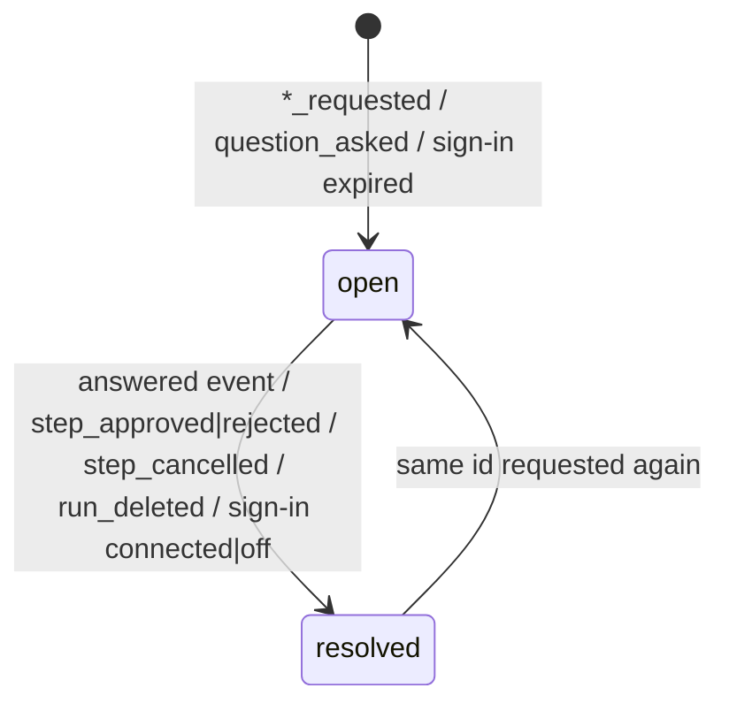

# core: inbox (projection, service, FCP bindings)

Part of the [`@workspace/core` spec](core.md). Covers `src/inbox/`.

The Inbox is a projection over the engine event log plus connector sign-in
status. Items are keyed by deterministic ids so a rebuild from the same
events yields the same items. Answers are not applied to the projection
directly: they are routed to the owning run (actor or ACP gate), whose new
events then resolve the item.

## Files

| File                        | Purpose                                                               |
| --------------------------- | --------------------------------------------------------------------- |
| `index.ts`                  | barrel                                                                |
| `projection.ts`             | state, item ids, `foldInboxEvent`, approval items, step/run cleanup   |
| `projection-permission.ts`  | `permissionItemId`, add/resolve permission items                      |
| `projection-question.ts`    | `questionItemId`, add/resolve question items                          |
| `projection-plan-review.ts` | `planReviewItemId`, add/resolve plan_review items                     |
| `projection-sign-in.ts`     | `signInItemId`, `applySignInStatus`                                   |
| `service.ts`                | `InboxService` (live fold, list, answer, dismiss, sign-in)            |
| `service-answer.ts`         | `answerInboxItem` (option parsing), `dismissOptionId`                 |
| `bind.ts`                   | `createInboxBindings` → `inbox/list`, `inbox/answer`, `inbox/dismiss` |

Barrel exports: `approvalItemId`, `emptyInboxProjection`, `foldInboxEvent`,
`foldInboxStored`, `openInboxItems`, `permissionItemId`, `planReviewItemId`,
`projectInbox`, `questionItemId`, `InboxChange`, `InboxDecision`,
`InboxItem`, `InboxProjectionState`, `applySignInStatus`, `signInItemId`,
`SignInStatusInput`, `createInboxService`, `InboxService`,
`InboxAnswerPush`, `InboxServiceDeps`, `createInboxBindings`,
`InboxBindings`.

## Item kinds

`InboxItem = WireInboxItem` (contracts `fcp/inbox.ts`). Common run-item
fields: `id, runId, workflowId?, nodeId, pass, question: string, at, status:
"open" | "resolved"`.

| Kind          | Id                                                | Extra fields                               | Created by event                                              | `question` text                                                              | Decision values                               |
| ------------- | ------------------------------------------------- | ------------------------------------------ | ------------------------------------------------------------- | ---------------------------------------------------------------------------- | --------------------------------------------- |
| `approval`    | `approval:<runId>:<nodeId>:<pass>`                | —                                          | `approval_requested` (node = `nodeId ?? taskId`, pass `?? 1`) | `event.question ?? "Approve?"`                                               | `approved` / `rejected`                       |
| `permission`  | `permission:<runId>:<nodeId>:<pass>:<requestId>`  | `tool, requestId`                          | `permission_requested`                                        | `event.question ?? event.tool`                                               | `allow-once` / `allow-always` / `reject-once` |
| `question`    | `question:<runId>:<nodeId>:<pass>:<requestId>`    | `requestId, title?, questions, answers?`   | `question_asked`                                              | `title`, else prompts joined by `" · "`                                      | `answered` / `skipped`                        |
| `plan_review` | `plan_review:<runId>:<nodeId>:<pass>:<requestId>` | `requestId, name?, overview?, plan, todos` | `plan_review_requested`                                       | `name` ?? `overview` ?? first non-blank trimmed plan line ?? `"Review plan"` | `accepted` / `rejected`                       |
| `sign_in`     | `sign_in:<connectorId>`                           | `connectorId` (no run fields)              | `applySignInStatus` with status `expired`                     | `"<name> sign-in expired"`                                                   | none                                          |

`workflowId` is filled from a `run_started` seen earlier in the same
projection (`workflowByRun` map); omitted otherwise.

## Projection (`projection.ts`)

```ts
type InboxProjectionState = { readonly items: ReadonlyMap<string, InboxItem>; readonly workflowByRun: ReadonlyMap<string, string> }
type InboxDecision = NonNullable<Exclude<InboxItem, { kind: "sign_in" }>["decision"]>
type InboxChange =
  | { kind: "item_added"; item: InboxItem }
  | { kind: "item_resolved"; itemId: string; decision?: InboxDecision }
emptyInboxProjection(): InboxProjectionState
foldInboxEvent(state, event: EngineEvent): { state; changes: InboxChange[] }
foldInboxStored(state, stored: StoredEvent)   // = foldInboxEvent(state, stored.event)
projectInbox(events: readonly StoredEvent[]): InboxProjectionState   // silent rebuild
openInboxItems(state): InboxItem[]   // status open, sorted by at (localeCompare) then id
```

All folds are immutable (new `Map`s).

| Event                                                                                      | Effect                                                                                                                                         |
| ------------------------------------------------------------------------------------------ | ---------------------------------------------------------------------------------------------------------------------------------------------- |
| `run_started`                                                                              | record `runId → workflowId` (no change)                                                                                                        |
| `approval_requested` / `permission_requested` / `question_asked` / `plan_review_requested` | add item (open). If an item with that id is already **open**, no-op; a resolved item with the same id is **replaced** by a new open item       |
| `step_approved` / `step_rejected`                                                          | resolve the approval item with `approved` / `rejected`                                                                                         |
| `permission_answered`                                                                      | resolve permission item with `optionId`                                                                                                        |
| `question_answered`                                                                        | resolve question item (must be kind question) with `outcome`; copy `answers` onto the item when present (the change carries only the decision) |
| `plan_review_answered`                                                                     | resolve plan_review item with `outcome`                                                                                                        |
| `step_cancelled`                                                                           | resolve (no decision) every open non-sign-in item with that `runId, nodeId, pass`                                                              |
| `run_deleted`                                                                              | resolve (no decision) every open non-sign-in item of that run                                                                                  |
| other                                                                                      | no change                                                                                                                                      |

`resolveItem` is a no-op when the item is missing, not open, or a sign-in
item. A resolved item keeps all fields plus `status: "resolved"` and
`decision` when one is given.



### Sign-in (`projection-sign-in.ts`)

```ts
type SignInStatusInput = { connectorId: string; name: string; status: ConnectorStatus; at: string }
applySignInStatus(state, input): { state; changes }
```

`status === "expired"` → add `{id: "sign_in:<id>", kind: "sign_in",
connectorId, question: "<name> sign-in expired", at, status: "open"}` (no-op
if already open). Any other status (`connected`, `off`, ...) → resolve the
open sign-in item (no decision).

## Service (`service.ts`)

```ts
type InboxAnswerPush = (input: {
  runId: string; at: string; nodeId: string; pass: number
  optionId: InboxDecision; requestId?: string; answers?: CursorAskAnswer[]
  kind: "approval" | "permission" | "question" | "plan_review"
}) => Promise<void>
type InboxServiceDeps = { bus: UpdateBus; clock: Clock; pushAnswer: InboxAnswerPush; events?: EventStore }
class InboxService {
  apply(stored: StoredEvent): void
  rebuild(events: readonly StoredEvent[]): void
  list(params: { cursor?: string; limit?: number }): { items: WireInboxItem[]; next?: string }
  get(itemId: string): InboxItem | undefined
  openItems(): InboxItem[]
  applyConnectorStatus(input: SignInStatusInput): void
  answer(itemId: string, optionId: string, answers?: readonly CursorAskAnswer[]): Promise<void>
  dismiss(itemId: string): Promise<void>
}
createInboxService(deps): InboxService
```

- `apply(stored)`: idempotent by **store seq** (an `applied` set); folds;
  when live, publishes each change on the UpdateBus as notification
  `inbox/update` with params `{kind: "item_added", item}` or `{kind:
"item_resolved", itemId, decision?}` (the bus stamps `seq`).
- `rebuild(events)`: not live while folding (no publishes), resets state and
  the applied set, then applies every event; live again after.
- `list({cursor?, limit?})`: open items in `openInboxItems` order. Start
  after the item whose id equals `cursor` (unknown cursor → empty page).
  Page size `limit ?? all`. `next` = last item id of the page, only when more
  items follow.
- `applyConnectorStatus(input)`: fold `applySignInStatus`, publish changes
  when live.
- `answer(itemId, optionId, answers?)`: the item must exist and be open, else
  `EngineError("not_found", "Inbox item not found: <itemId>")`. Then
  `answerInboxItem` validates and routes (below).
- `dismiss(itemId)`: same not-found rule. A sign-in item is resolved locally
  via `applyConnectorStatus({connectorId, name: connectorId, status:
"connected", at: now})`. Run items route with `dismissOptionId(item)`:
  approval/plan_review → `rejected`, question → `skipped`, permission →
  `reject-once`, so the run never stays parked.
- Routing: `pushAnswer({runId, at: ISO(clock.now()), nodeId, pass, kind,
optionId, requestId (permission/question/plan_review only), answers?})`,
  then if `deps.events` is set, re-read that run's events and `apply` each
  (dedup by seq), so the answered/approved event resolves the item and
  publishes `item_resolved` before the FCP call returns.

### answerInboxItem (`service-answer.ts`)

| Item kind     | Validation                                                                                                            | Error                                                                                                                                            |
| ------------- | --------------------------------------------------------------------------------------------------------------------- | ------------------------------------------------------------------------------------------------------------------------------------------------ |
| `sign_in`     | always refused                                                                                                        | `EngineError("failed_precondition", "Sign-in items resolve when the connector is connected")` (not an FCP code, so it maps to JSON-RPC internal) |
| `approval`    | `optionId ∈ {approved, rejected}`                                                                                     | `invalid_params "Unknown optionId for approval: <id>"`                                                                                           |
| `question`    | `optionId ∈ {answered, skipped}`; `answered` requires `answers` passing `validateAskAnswers(item.questions, answers)` | `invalid_params "Unknown optionId for question: <id>"`, `invalid_params "Invalid or incomplete answers for question"`                            |
| `plan_review` | `optionId ∈ {accepted, rejected}`                                                                                     | `invalid_params "Unknown optionId for plan_review: <id>"`                                                                                        |
| `permission`  | `optionId ∈ {allow-once, allow-always, reject-once}`                                                                  | `invalid_params "Unknown optionId for permission: <id>"`                                                                                         |

Answers are passed to the route only for `question` + `answered`.

The host's `pushAnswer` routes `approval` to the run actor (`answer` input,
then `wake`) and the ACP kinds to `AcpAsks.answer` (see
[core-agents.md](core-agents.md)).

Test invariants: rebuild yields the same open items as a live fold; an
approval wait appears, `answer` routes to the actor and resolves the item;
`dismiss` rejects the approval through the actor; answering a missing item
fails `not_found`.

## FCP bindings (`bind.ts`)

```ts
type InboxBindings = Pick<MethodBindings, "inbox/list" | "inbox/answer" | "inbox/dismiss">
createInboxBindings(service: InboxService): InboxBindings
```

| Method          | Kind    | Params                                     | Result           | Handler                                     |
| --------------- | ------- | ------------------------------------------ | ---------------- | ------------------------------------------- |
| `inbox/list`    | query   | `{cursor?, limit? (≤ list max)}`           | `{items, next?}` | `service.list(params)`                      |
| `inbox/answer`  | command | `{itemId, optionId, answers?, requestKey}` | `{}`             | `service.answer(itemId, optionId, answers)` |
| `inbox/dismiss` | command | `{itemId, requestKey}`                     | `{}`             | `service.dismiss(itemId)`                   |

Notification `inbox/update` params: `{seq, kind: "item_added", item}` or
`{seq, kind: "item_resolved", itemId, decision?}`.
