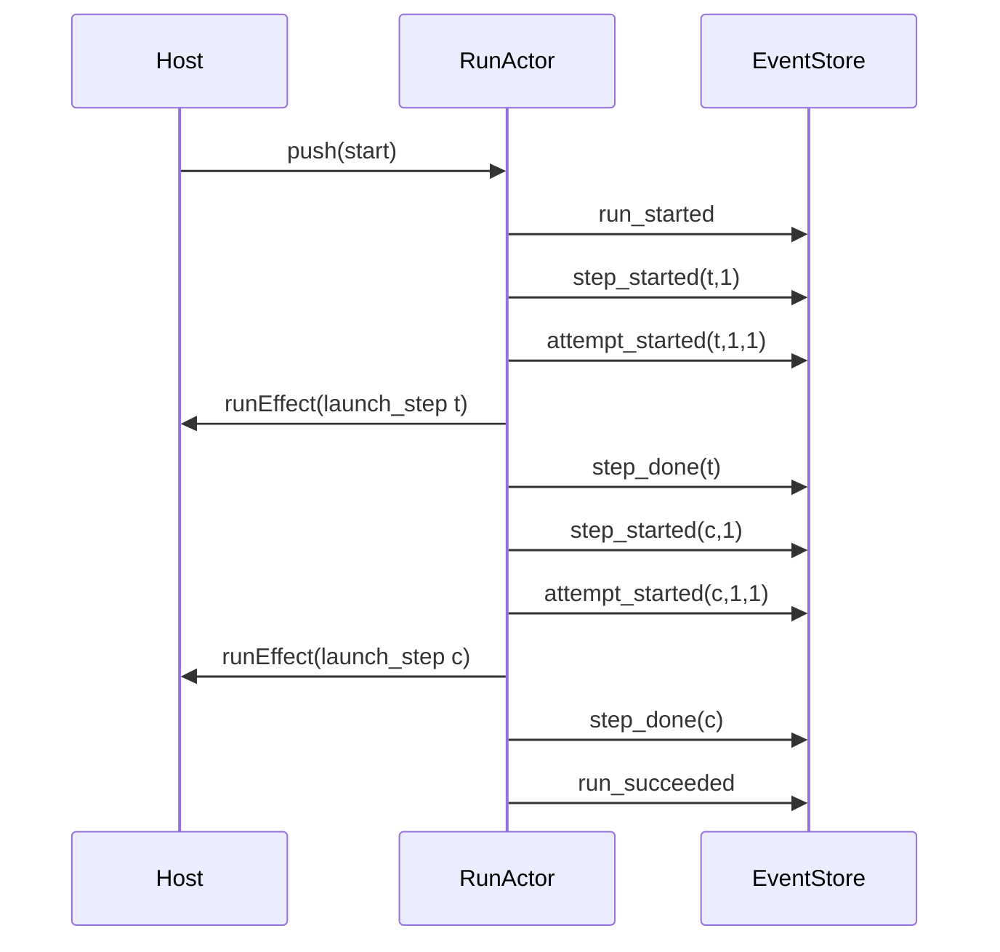
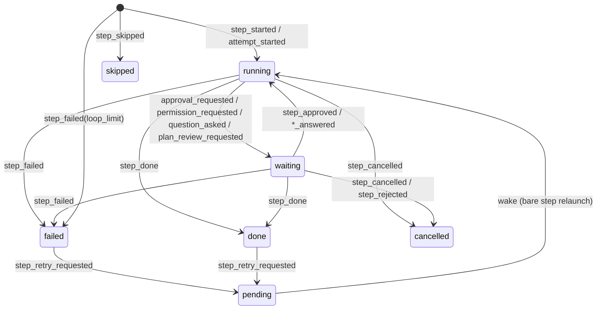
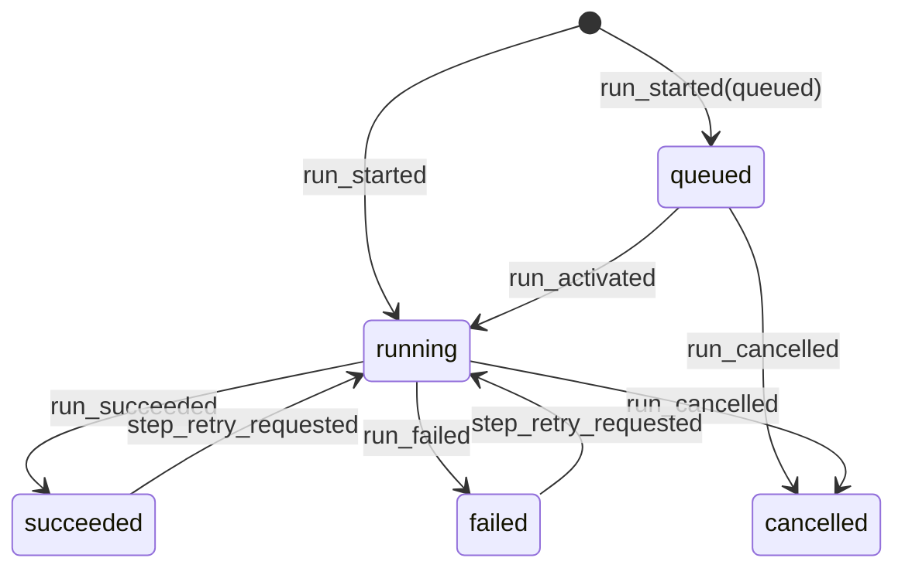

# core: runs (decide, fold, walk, actor, scheduler)

Part of the [`@workspace/core` spec](core.md). Covers `src/runs/`.

The run engine is event-sourced: a pure `decide(state, input)` turns a
mailbox input into new `EngineEvent`s (from `@workspace/contracts`
`events.ts`) plus `RunEffect`s; a pure `fold(state, event)` rebuilds
`RunState`; `RunActor` serializes inputs per run, appends events to the
`EventStore`, and runs effects through a host callback. `decide` and `fold`
never read the clock: time arrives as an ISO string `at` in every input.

## Files

| File                 | Purpose                                                                                                                                        |
| -------------------- | ---------------------------------------------------------------------------------------------------------------------------------------------- |
| `index.ts`           | barrel (list below)                                                                                                                            |
| `model.ts`           | `StepStatus`, `StepFailReason`, `AttemptInfo`, `StepState`, `StepsState`, `RunState`, `DecideInput`, `DecideOutput`, walk types, small helpers |
| `effect-types.ts`    | `RunEffect`, `EffectResult`, `NoticeChannel`                                                                                                   |
| `fold.ts`            | run-level fold (`fold`, `foldAll`) and re-export of step fold                                                                                  |
| `fold-steps.ts`      | step-level fold (`foldSteps`, `foldAllSteps`)                                                                                                  |
| `decide.ts`          | `decide` dispatcher and `start` handling                                                                                                       |
| `decide-schedule.ts` | `activate`, `retry_step`, `cancel`, `wake`                                                                                                     |
| `decide-next.ts`     | `scheduleNext`: first walk action, or end the run                                                                                              |
| `decide-effects.ts`  | `activeInputs`, `effectForRun`                                                                                                                 |
| `decide-result.ts`   | `effect_result` and approval `answer`                                                                                                          |
| `decide-inbox.ts`    | `permission_answer`, `question_answer`, `plan_review_answer`                                                                                   |
| `walk.ts`            | `forwardOrder`, `nextActions` (pure graph walk incl. loops)                                                                                    |
| `pending-effects.ts` | crash recovery: `pendingEffects`, `effectAttemptKey`                                                                                           |
| `actor.ts`           | `RunActor` mailbox                                                                                                                             |
| `scheduler.ts`       | `createScheduler`: global step cap + per-workflow run queues                                                                                   |
| `partial.ts`         | partial runs (`only` / `from`) seed planning                                                                                                   |
| `agent-update.ts`    | `mapAgentEventToRunUpdate`, `COALESCE_CHUNK_KINDS`                                                                                             |
| `coalesce.ts`        | `createRunUpdateCoalescer` (50 ms chunk merge)                                                                                                 |
| `decide-harness.ts`  | test-only helpers (`at`, `later`, `parse`, `runToEnd`); not exported from the barrel                                                           |

Barrel exports: `decide`, `RunActor`, `RunActorDeps`, `effectAttemptKey`,
`pendingEffects`, `assertPartialReady`, `canon`, `downstreamOf`, `onlySeeds`,
`partialRefusal`, `planPartialSeed`, `shell`, `PartialBase`, `PartialRun`,
`PartialSeedPlan`, `SeedCopy`, `COALESCE_CHUNK_KINDS`,
`mapAgentEventToRunUpdate`, `AgentRunUpdate`, `AgentUpdateContext`,
`COALESCE_WINDOW_MS`, `createRunUpdateCoalescer`, `RunUpdateCoalescer`,
`RunUpdateCoalescerOptions`, `ScheduleFn`, `createScheduler`, `Scheduler`,
`SchedulerGrant`, `SchedulerLimits`, `SchedulerRun`, `fold`, `foldAll`,
`foldAllSteps`, `foldSteps`, `emptySteps`, `isOpenStep`, `latestStep`,
`retryMax`, `AttemptInfo`, `DecideInput`, `DecideOutput`, `EffectResult`,
`RunEffect`, `RunState`, `StepFailReason`, `StepState`, `StepStatus`,
`StepsState`, `WalkAction`, `WalkGraph`, `WalkScope`, `forwardOrder`,
`nextActions`.

## Model (`model.ts`, `effect-types.ts`)

```ts
type StepStatus =
  | "pending"
  | "running"
  | "waiting"
  | "done"
  | "failed"
  | "skipped"
  | "cancelled"
type StepFailReason =
  | "exit"
  | "timeout"
  | "unclear"
  | "answer"
  | "loop_limit"
  | "conflict"
  | "rejected"
type AttemptInfo = {
  attempt: number
  startedAt: string
  pid?: number
  timeout?: number
  model?: string
  effort?: Effort
  modelSource?: ModelSource
  open: boolean
  exitCode?: number
  reason?: string
  interrupted?: boolean
  endedAt?: string
}
type StepState = {
  nodeId: string
  pass: number
  status: StepStatus
  attempts: number
  outputs?: string[]
  branch?: string
  answer?: Record<string, unknown>
  failReason?: StepFailReason
  question?: string
  waitingKind?: "approval" | "permission" | "question" | "plan_review"
  decision?: "approved" | "rejected"
  current?: AttemptInfo
  reused?: boolean
  seq: number // fold seq of the last status-changing event; later = newer
}
type StepsState = {
  steps: Readonly<Record<nodeId, readonly StepState[]>>
  ended: boolean
}
type RunState = {
  runId
  workflowId
  status: RunStatus /* queued|running|succeeded|failed|cancelled */
  graph: Workflow
  steps: StepsState
  trigger?
  only?
  from?
  startedAt?
  finishedAt?
  cancelRequested?: boolean
  deleted?: boolean
  cardId?: string
  seq: number // 1-based count of folded events (NOT the store seq)
}
type DecideOutput = { events: EngineEvent[]; effects: RunEffect[] }
type WalkGraph = {
  nodes: readonly { id: string; kind: string }[]
  edges: readonly WorkflowEdge[]
}
type WalkScope = { trigger: string; only?: string; loopPasses?: number }
type WalkAction =
  | { type: "run"; nodeId; pass; inputs: string[] }
  | { type: "skip"; nodeId; pass }
  | { type: "fail"; nodeId; pass; reason: "loop_limit" }
```

`DecideInput` (all carry `at: string`):

| kind                 | extra fields                                                                                                                |
| -------------------- | --------------------------------------------------------------------------------------------------------------------------- |
| `start`              | `runId, graph: Workflow, trigger?, only?, from?, queued?, cardId?, seed?: readonly EngineEvent[]`                           |
| `effect_result`      | `nodeId, pass, result: EffectResult, retryBackoffMs?`                                                                       |
| `answer`             | `nodeId, pass, decision: "approved" \| "rejected"`                                                                          |
| `permission_answer`  | `nodeId, pass, requestId, optionId: "allow-once" \| "allow-always" \| "reject-once"`                                        |
| `question_answer`    | `nodeId, pass, requestId, outcome: "answered" \| "skipped", answers?: {questionId, selectedOptionIds: string[]}[], reason?` |
| `plan_review_answer` | `nodeId, pass, requestId, outcome: "accepted" \| "rejected", reason?`                                                       |
| `cancel`             | —                                                                                                                           |
| `activate`           | —                                                                                                                           |
| `retry_step`         | `nodeId`                                                                                                                    |
| `agent_event`        | `nodeId, pass, event: { type: string }` (no-op)                                                                             |
| `wake`               | `retryBackoffMs?`                                                                                                           |

```ts
type NoticeChannel = "app" | "system"
type RunEffect =
  | { kind: "launch_step"; nodeId; pass; attempt: number }
  | { kind: "post_inbox"; nodeId; pass; question: string }
  | { kind: "write_output"; nodeId; pass; from: readonly string[] }
  | { kind: "notify"; nodeId; pass; title: string; from: readonly string[] }
type EffectResult =
  | {
      ok: true
      outputs?: string[]
      branch?: string
      answer?: Record<string, unknown>
      notice?: { title: string; text: string; channel?: NoticeChannel }
    }
  | {
      ok: false
      reason: "exit" | "timeout" | "unclear" | "answer"
      message?: string
      attempt?: {
        attempt: number
        exitCode?: number
        interrupted?: boolean
        endedAt: string
      }
    }
  | { waiting: true; question: string }
  | { fix: true }
```

Helpers: `isOpenStep(s)` — status in {pending, running, waiting};
`latestStep(steps, nodeId)` — last element of the node's list (lists are kept
sorted by `pass`); `emptySteps()` → `{ steps: {}, ended: false }`;
`retryMax(node)` → `node.retry?.max` or `undefined`.

## Fold (`fold.ts`, `fold-steps.ts`)

`fold(state | null, event): RunState | null`.

- `run_started` always (re)initializes: `status = queued` if
  `event.queued === true` else `running`; copies `runId, workflowId, graph,
trigger, only, from, cardId`; `startedAt = at`; `steps = emptySteps()`;
  `seq = 1`. The step fold is **not** applied to `run_started`.
- Any other event with `state === null` → `null` (ignored).
- Otherwise `seq = state.seq + 1`, then run-level changes, then
  `steps = foldSteps(state.steps, event, seq)`:

| Event                                            | Run-level effect                                                                          |
| ------------------------------------------------ | ----------------------------------------------------------------------------------------- |
| `run_activated`                                  | `queued` → `running` (otherwise no change)                                                |
| `cancel_requested`                               | `cancelRequested = true`                                                                  |
| `run_cancelled` / `run_succeeded` / `run_failed` | `status` = type minus `run_` prefix; `finishedAt = at`                                    |
| `run_deleted`                                    | `deleted = true`                                                                          |
| `step_retry_requested`                           | if status `failed` or `succeeded` → `running`, `finishedAt = undefined` (cancelled stays) |

`foldSteps(state, event, seq)`. "Upsert" (`withStep`) finds the step by
`(nodeId, pass)`; when missing creates `{nodeId, pass, status:"pending",
attempts:0, seq}` and inserts keeping the list sorted by `pass`.

| Event                                                                | Guard                                                             | Step change                                                                                                               |
| -------------------------------------------------------------------- | ----------------------------------------------------------------- | ------------------------------------------------------------------------------------------------------------------------- |
| `step_started`                                                       | —                                                                 | upsert; `status=running`, `seq`                                                                                           |
| `attempt_started`                                                    | needs `nodeId` (else ignored); `pass ?? 1`                        | `attempts = max(attempts, attempt)`, `status=running`, `current = {attempt, startedAt: at, open: true}`                   |
| `attempt_launched`                                                   | needs `nodeId`                                                    | if `current.attempt === attempt`: merge `pid, timeout, model, effort, modelSource`                                        |
| `attempt_finished`                                                   | needs `nodeId`                                                    | if attempt matches: `open=false, endedAt=at, exitCode, reason`                                                            |
| `attempt_interrupted`                                                | needs `nodeId`                                                    | if attempt matches: `open=false, endedAt=at, interrupted=true`                                                            |
| `approval_requested`                                                 | node = `nodeId ?? taskId`, pass `?? 1`; step exists and `running` | `status=waiting, waitingKind=approval`, `question` if defined                                                             |
| `permission_requested`                                               | step `running` or `waiting`                                       | `waiting`, `waitingKind=permission`, `question` if defined                                                                |
| `question_asked`                                                     | step `running` or `waiting`                                       | `waiting`, `waitingKind=question`, `question = title ?? questions.map(q=>q.prompt).join(" · ")`                           |
| `plan_review_requested`                                              | step `running` or `waiting`                                       | `waiting`, `waitingKind=plan_review`, `question = name ?? overview ?? first non-blank trimmed plan line ?? "Review plan"` |
| `permission_answered` / `question_answered` / `plan_review_answered` | step `waiting`                                                    | `running`, clear `waitingKind` and `question`                                                                             |
| `step_approved`                                                      | step `waiting`                                                    | `running`, clear `waitingKind`, `decision=approved`                                                                       |
| `step_done`                                                          | —                                                                 | `done`, `outputs, branch, answer, reused`, `seq`                                                                          |
| `step_failed`                                                        | —                                                                 | `failed`, `failReason = reason`, `seq`                                                                                    |
| `step_skipped`                                                       | —                                                                 | `skipped`, `reused`, `seq`                                                                                                |
| `step_rejected`                                                      | —                                                                 | `cancelled`, `decision=rejected`, `seq`                                                                                   |
| `step_cancelled`                                                     | —                                                                 | `cancelled`, `seq`                                                                                                        |
| `step_retry_requested`                                               | step exists                                                       | reset to `{nodeId, pass, status:"pending", attempts (kept), seq}` (drops outputs, current, decision...); `ended = false`  |
| `run_succeeded` / `run_failed` / `run_cancelled`                     | —                                                                 | `ended = true`                                                                                                            |
| anything else                                                        | —                                                                 | unchanged                                                                                                                 |

Note `step_started` does not reset `current`; the decide layer relies on
"running with no `current`" meaning "started, never launched".

`foldAll(events)` folds from `null`; `foldAllSteps(events)` folds steps from
empty using `i + 1` as seq.

## Decide (`decide.ts` and friends)

`decide(state, input)`: every input except `start` returns empty output
when `state` is `null`. `agent_event` always returns empty output.

### start

`trigger = input.trigger ?? first node with kind "trigger"`. Emits one
`run_started { runId, at, workflowId: graph.id, graph, source: "manual",
trigger?, only?, from?, queued: true (only if truthy), cardId? (if !==
undefined) }`, followed by `input.seed` events verbatim (partial-run reused
steps). No effects.

### activate

Status `queued` → `[run_activated]`; else empty.

### retry_step (manual retry)

Throws `Error("task <nodeId> cannot be retried")` unless the latest step of
`nodeId` is `failed`, the run is ended (`steps.ended`), and status is not
`cancelled`. Computes the forward closure of `nodeId` over **all** edges
(loop edges included) and emits `step_retry_requested` for the latest pass of
each node in that set that has a step, iterating the set in insertion order.
No effects; the following `wake` relaunches.

### cancel

If `steps.ended` → empty. Else: `cancel_requested` (only when not already
`cancelRequested`), then `step_cancelled` for every open step (pending,
running, waiting), then `run_cancelled` with `reason: "rejected"` when any
step has `decision === "rejected"`.

### wake (one scheduling pass)

`retryBackoffMs` default **2000**. Order:

1. `steps.ended` or status `queued` → empty.
2. `cancelRequested` → same as `cancel`.
3. First step (iteration order: node keys in insertion order, then pass
   order) that is `running` with `decision === "approved"` → effect
   `launch_step {attempt: max(1, attempts)}`; no events. (Approval resumes by
   relaunching the step.)
4. First `running` step whose `current` exists and is closed → settle:
   - not interrupted and `exitCode === 0` → empty (awaiting the
     `effect_result`).
   - node has `retry.max` and `attempts < max`: if
     `Date.parse(at) < Date.parse(current.endedAt ?? at) + retryBackoffMs *
2^(attempts-1)` → empty (wait); else effect `effectForRun(..., attempts +
1)` with active inputs.
   - else `step_failed { reason: current.reason === "timeout" ? "timeout" :
"exit" }`.
5. First `running` step with no `current` and not approved ("bare", e.g.
   started then crashed, or retried) → `effectForRun(state, node, pass,
activeInputs, max(1, attempts))`; no events.
6. `scheduleNext`.

### scheduleNext (`decide-next.ts`)

Calls `nextActions(graph, { trigger: only ?? trigger ?? "", only,
loopPasses: graph.limits?.loopPasses }, steps)`.

- No actions: if any open step → empty. Else `run_failed` if any step is
  `failed`, otherwise `run_succeeded`.
- Only the **first** action is taken:
  - `fail` → `step_started` + `step_failed {reason: "loop_limit"}`.
  - `skip` → `step_skipped`.
  - `run` → `step_started` + effect `effectForRun(..., a.inputs, 1)`.

### effectForRun / activeInputs (`decide-effects.ts`)

`effectForRun`: node `kind === "output" && target === "folder"` →
`write_output { from: inputs }`; every other node (including trigger,
approval, output/notify) → `launch_step { attempt }`.

`activeInputs(state, nodeId)`: in edge-file order, `e.from` of each edge into
`nodeId` whose source's latest step is `done` and (edge has no branch or
`e.branch === step.branch`).

### effect_result (`decide-result.ts`)

Step looked up by exact `(nodeId, pass)`; if missing or not
`running`/`waiting` → empty (late results are dropped).

| Result                      | Output                                                                                                                                                      |
| --------------------------- | ----------------------------------------------------------------------------------------------------------------------------------------------------------- |
| `{waiting: true, question}` | event `approval_requested {taskId: nodeId, nodeId, pass, question}` + effect `post_inbox {question}`                                                        |
| `{fix: true}`               | effect `launch_step {attempt: step.attempts + 1}` (no event)                                                                                                |
| `{ok: true}`                | `step_done {outputs: outputs ?? [], branch?, answer?}` (branch/answer only when truthy); if `notice` → also effect `notify {title: notice.title, from: []}` |
| `{ok: false}`               | `settleFailure` below                                                                                                                                       |

`settleFailure` (default backoff 2000): `attempts = result.attempt?.attempt
?? step.attempts`. If the node has `retry.max`, `attempts < max`, and reason
is `exit` or `timeout`: wait `retryBackoffMs * 2^(max(1,attempts)-1)` from
`result.attempt?.endedAt ?? at`; if not yet elapsed → empty; otherwise emit
`attempt_finished {at: endedAt, attempt, exitCode: exitCode ?? 1, reason}`
(only when `result.attempt` was given) and effect `launch_step {attempt:
attempts + 1}`. Otherwise `step_failed {reason: result.reason}`.

### answer (approval)

Latest step of `nodeId` must match `pass` and be `waiting`, and
`waitingKind` must not be permission/question/plan_review (else empty).
`rejected` → `step_rejected`; `approved` → `step_approved`. No effects; the
host pushes a `wake` right after the answer.

Rejection consequence (follows from the rules, not special-cased): after
`step_rejected` the step is `cancelled`, so the walk treats it as `ended`;
downstream nodes get no active input and are `skipped`; the run then ends
`run_succeeded` unless some other step failed. `run_cancelled {reason:
"rejected"}` is only produced when a `cancel` input arrives while the run is
not yet ended and some step carries `decision: "rejected"`.

### permission/question/plan_review answers (`decide-inbox.ts`)

Each requires latest step matches `pass`, `waiting`, and `waitingKind`
equal to `permission` / `question` / `plan_review` respectively; emits one
`permission_answered {requestId, optionId}` / `question_answered {requestId,
outcome, answers? (copied), reason?}` / `plan_review_answered {requestId,
outcome, reason?}`. No effects. The live ACP session holds the actual
request; these events only record and resume step status.

## Walk (`walk.ts`)

`forwardOrder(graph)`: Kahn topological order over non-loop edges
(`findLoopEdges` from contracts), ties broken by node order in the file (each
step picks the first id in file order with indegree 0). Throws
`edge <from> -> <to> names an unknown node` and `loop edges left a cycle`.

`findLoopEdges` (contracts, summarized for parity): DFS from every node with
no incoming edges in file order, visiting outgoing edges sorted by target
file order then edge index; an edge to a node currently on the stack is a
loop edge (self edges included). `DEFAULT_LOOP_PASSES = 5`. Source kinds
(`PORT_TABLE[kind].in` empty): `trigger`, `prompt`, `asset`.

`nextActions(graph, scope, steps)`: one pass over `forwardOrder`, computing
for each node an effective state `eff ∈ {none, open, done(branch), ended}`
and collecting actions:

1. If `scope.only` is set and `id !== only`: `eff = latest ?
terminalEff(latest) : none` (`terminalEff` = `done(branch)` if status done,
   else `ended`); continue.
2. `incoming` = all edges into id (flagged loop/forward); `forward` = non-loop.
   `pass = latest?.pass ?? 1`.
3. If `latest` exists and is not `pending`:
   - `running`/`waiting` → `open`; continue.
   - `stale` = some forward source has `eff === open`.
   - `newer` = some incoming edge `e` whose source latest step `feeds` (is
     `done` and branch matches) and (`e.from === id` (self loop) or
     `src.seq > latest.seq`); but if both `latest.reused` and `src.reused`
     the edge does not count.
   - if `stale || !newer || isSource`: `eff = (stale && !isSource) ? open :
terminalEff(latest)`; continue.
   - else new pass: `pass = latest.status === "skipped" ? latest.pass :
latest.pass + 1`.
4. Source node: a `trigger` other than `scope.trigger` → `none`; otherwise
   action `run {inputs: []}` and `open`.
5. Non-source: `states` = eff of each forward source (`none` if unset). Any
   `open` → `open`. All `none` (or no forward edges) → `none`.
6. `active` = incoming edges where: loop edge → its source's latest step
   feeds it; forward edge → source eff is `done` and branch matches.
   - none active → action `skip` and `ended`;
   - else `pass > limit` (`scope.loopPasses ?? 5`) → action `fail
loop_limit` and `ended`;
   - else action `run {inputs: active sources}` and `open`.

Consequences (from the ported tables): a Judge loop `t→a→j`, `j→a [no]`,
`j→ok [yes]` with two "no"s gives `a` passes 1..3 done, `j` 1..3
(no,no,yes), `ok` pass 1. With `loopPasses: 2` and an always-"no" judge:
`a` = `1:done, 2:done, 3:failed(loop_limit)`, `j` = 2 passes, run `failed`.
Nested loops rerun the inner loop each outer round; a self loop on a Judge
asks again until "yes". A failed upstream makes downstream steps `skipped`
one per wake (the actor drains these in one go).

## RunActor (`actor.ts`)

```ts
type RunActorDeps = {
  events: EventStore
  runEffect: (effect: RunEffect, state: RunState) => Promise<EffectResult>
}
class RunActor {
  constructor(readonly runId: string, deps: RunActorDeps)
  getState(): RunState | null
  push(input: DecideInput): Promise<void>      // resolves/rejects when that input is handled
  decideAndAppend(input: DecideInput): RunEffect[]   // test hook: decide+append, return effects unrun
  recover(): Promise<void>
}
```

Private state: `state`, FIFO `mailbox`, `draining` flag, `issued:
Set<"node:pass:attempt">`, `storeSeq` (the EventStore global seq of this
run's last row — never compare with `RunState.seq`).

- **Mailbox:** `push` enqueues and starts `drain` unless already draining.
  Inputs are handled strictly one at a time; a throw rejects only that
  input's promise. After draining, if new entries arrived, drain again.
- **handle(input):** `decide`; append events (if any); run each effect via
  `runOneEffect` in order; if the input was `start` and the run is now
  `running`, `drainSchedule(input.at)`.
- **drainSchedule(at):** up to 1000 iterations while `status === "running"`:
  `decide(wake)`; stop on empty output; append events; if there are
  effects, run them all and **return** (the effects' own completion drives
  further scheduling).
- **append(events):** first `catchUp()` (fold rows appended to the store
  outside the actor, e.g. ACP permission/question/plan events, starting at
  index `state.seq` of `events.read(runId)`; updates `storeSeq`), then
  `events.append(runId, events, {expectSeq: storeSeq})`. Conflict throws
  `Error("event append conflict: expected <n>, got <lastSeq>")`. Folds the
  appended rows and sets `storeSeq = lastSeq`.
- **runOneEffect(fx):** `at = new Date().toISOString()` (the actor is the
  shell, so it may read the wall clock). For `launch_step` whose key
  (`node:pass:attempt`) is not in `issued`, append `attempt_started
{taskId: nodeId, nodeId, pass, attempt}` first; add key to `issued`.
  - `post_inbox`: await `runEffect` and return (the step waits for an
    `answer` input; no `effect_result`).
  - otherwise await `runEffect`, then `handle({kind:"effect_result", at,
nodeId, pass, result})`, then `drainSchedule(at)` if still running.
  - If `runEffect` throws a `DOMException` named `AbortError` → return,
    leaving the step open (a queued `cancel` settles it). Any other throw →
    `handle(effect_result {ok:false, reason:"exit", message: err.message ??
String(err)})` then `drainSchedule`.
  - Effects nest: an effect result can produce further effects, run
    recursively inside the same mailbox entry.
- **recover():** reset `state`, `storeSeq`, `issued`; fold all stored rows
  (setting `storeSeq` per row and adding `issued` keys from
  `attempt_started` rows with a `nodeId`); if a state exists, run every
  `pendingEffects(state)` through `runOneEffect` sequentially.

Event sequence for a simple `trigger → command` run, driven by the host
(`start` then the actor's own `drainSchedule`):



(Hosts additionally append `attempt_launched` / `attempt_finished` via the
node effect runner; see [core-nodes.md](core-nodes.md).)

### Step state machine



### Run state machine



## Recovery (`pending-effects.ts`)

`effectAttemptKey(fx)`: `launch_step` → `${nodeId}:${pass}:${attempt}`;
others → `${kind}:${nodeId}:${pass}`.

`pendingEffects(state)`: for each step (node insertion order, pass order),
deduplicated by key:

| Step                                                         | Effect                                                     |
| ------------------------------------------------------------ | ---------------------------------------------------------- |
| `waiting` with `waitingKind` permission/question/plan_review | none (held by the live ACP session)                        |
| other `waiting`                                              | `post_inbox { question: step.question ?? "Approve?" }`     |
| `running` with `current.open`                                | `launch_step { attempt: current.attempt }`                 |
| `running` with no `current`                                  | `effectForRun(..., activeInputs, max(1, attempts \|\| 1))` |
| otherwise                                                    | none                                                       |

Recovery invariant (test): a crash between append and effect does not
duplicate a step; re-running `pendingEffects` is idempotent by attempt id,
and `recover` does not re-append `attempt_started` for keys already in the
log.

## Scheduler (`scheduler.ts`)

Pure in-memory policy; the host consults it before launching steps and
starting runs.

```ts
type SchedulerGrant = { runId: string; stepId: string }
type SchedulerRun = { runId: string; workflowId: string; at: string }
type SchedulerLimits = {
  maxConcurrent: number                                     // global step cap
  maxConcurrentRuns?: number | ((workflowId: string) => number)   // default 1
}
type Scheduler = {
  request(runId, stepId): void; release(runId, stepId): void; cancel(runId): void
  grants(): readonly SchedulerGrant[]
  admit(runId, workflowId, at): "running" | "queued"
  forceRunning(runId, workflowId, at): void
  endRun(runId): void
  activeRuns(): readonly SchedulerRun[]; queuedRuns(): readonly SchedulerRun[]
}
createScheduler(limits): Scheduler   // throws "maxConcurrent must be a positive integer"
```

Steps: `granted: Map<"runId\0stepId", grant>`, FIFO `pending`.

- `request`: no-op if already granted or pending; grant immediately when
  `granted.size < maxConcurrent`, else append to pending.
- `release`: remove the grant and any pending entry, then fill from pending
  (FIFO, skipping duplicates) while under the cap.

Runs: `active: Map<runId, SchedulerRun>`, `queued: SchedulerRun[]`.

- `admit`: already active → `running`; already queued → `queued`; else
  active if the workflow's running count `< cap` (cap from the function, the
  number, or 1) else queued.
- `forceRunning`: remove from queue if present; mark active (ignores cap;
  used for manual retry).
- `endRun`: drop the run's grants and pending requests, fill steps, remove
  from active and `fillRuns`.
- `cancel`: drop grants/pending and fill steps; if the run was queued, just
  remove it (frees nothing); else end it like `endRun`.
- `fillRuns`: sort queue by `at` ascending (string compare), ties by
  `runId.localeCompare`; activate every queued run whose workflow is under
  cap (FIFO by `run_started.at`, not admit order; after replay, freed slots
  activate queued runs in `at` order).
- `grants()`, `activeRuns()`, `queuedRuns()` return copies.

## Partial runs (`partial.ts`)

```ts
type PartialRun = { only?: string; from?: string; bases: readonly string[] } // bases: earlier runIds newest first
type PartialBase = {
  runId: string
  graph: Workflow
  steps: StepsState
  stepRun: boolean
}
type SeedCopy = { fromRunId: string; nodeId: string; pass: number }
type PartialSeedPlan = { copies: SeedCopy[]; events: EngineEvent[] }
```

- `canon(value)`: `JSON.stringify` with object keys sorted (arrays keep
  order).
- `downstreamOf(graph, id)`: all nodes reachable from `id` over any edge,
  including `id`.
- `shell(graph)`: `canon` of the workflow minus `nodes` and `edges`.
- `partialRefusal(graph, {only, from})`: neither → `undefined`; both →
  `"Use only or from, not both"`; target id not in graph → `"Unknown node
<id>"`.
- `onlySeeds(graph, only, bases)`: for each distinct source of edges into
  `only`, the latest `done` step from the first base (newest first) that has
  one; else throw `Run <source> first: it has no result to read yet`.
- `planPartialSeed({runId, at, graph, partial, bases, unchanged})`: throws
  the refusal; for `only` → seeds from `onlySeeds`. For `from`: base = first
  base with `stepRun === false`; none → empty plan. `rerun =
downstreamOf(from)`. If `shell(graph) !== shell(base.graph)` → empty plan.
  Walk `forwardOrder(graph)`: skip nodes in `rerun`; reuse a node when its
  latest base step is `done` or `skipped`, `unchanged(base, id)` is true, and
  every edge source into it was already reused.
- Seed events: `done` → `step_done {outputs: outputs ?? [], branch?,
answer?, reused: true}`; otherwise `step_skipped {reused: true}`; each also
  yields a `SeedCopy` (host copies the step's files).
- `assertPartialReady({graph, partial, bases})`: throws the refusal; for
  `only`, runs `onlySeeds` (throws when an input has no result).

Seeded events are passed as `start.seed`. With `only`, the walk scope's
trigger is the `only` node; with reused sources the `reused`/`reused` rule
in `nextActions` keeps reused steps from re-triggering each other.

## Agent updates (`agent-update.ts`, `coalesce.ts`)

```ts
type AgentRunUpdate = { kind: string; runId: string; stepId: string; [k: string]: unknown }
type AgentUpdateContext = { runId: string; stepId: string }
const COALESCE_CHUNK_KINDS = new Set(["agent_message_chunk", "agent_thought_chunk"])
mapAgentEventToRunUpdate(event: AgentEvent, ctx): AgentRunUpdate | null
```

| AgentEvent         | run/update payload (plus `runId`, `stepId`)                              |
| ------------------ | ------------------------------------------------------------------------ |
| `message_chunk`    | `{kind:"agent_message_chunk", text}`                                     |
| `thought_chunk`    | `{kind:"agent_thought_chunk", text}`                                     |
| `tool_call`        | `{kind:"tool_call", id, title, toolKind, status}` (input dropped)        |
| `tool_call_update` | `{kind:"tool_call_update", id, status, content?}` (input/output dropped) |
| `plan` / `todos`   | `{kind, entries}`                                                        |
| `subagent`         | `{kind:"subagent", id, description, subagentType, durationMs?}`          |
| `usage`            | `{kind:"usage", used, size, cost?}`                                      |
| `stop`             | `null`                                                                   |

```ts
const COALESCE_WINDOW_MS = 50
type ScheduleFn = (cb: () => void, ms: number) => () => void // returns cancel
type RunUpdateCoalescerOptions = {
  publish(u: AgentRunUpdate): void
  schedule?: ScheduleFn
  windowMs?: number
}
type RunUpdateCoalescer = {
  push(u): void
  flush(runId?: string): void
  dispose(): void
}
```

- Non-chunk kinds: flush all pending chunks of that run (insertion order),
  then publish immediately.
- Chunk kinds: key `runId\0stepId\0kind`. If pending, append text (non-string
  text coerced with `String(text ?? "")`); else schedule a publish after
  `windowMs` (default `setTimeout`) and store `{...update, text}`.
- `flush(runId?)`: publish pending for that run, or all. `dispose()`:
  cancel timers and drop pending without publishing.
