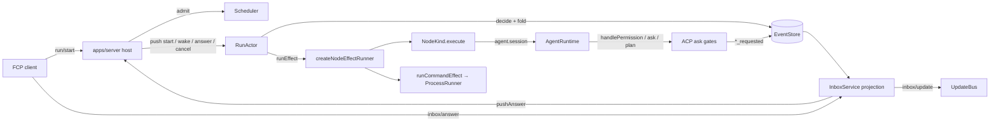

# `@workspace/core` — UI-free engine kernel

Path: `packages/core`. Pure TypeScript domain logic for Flows: ports
(interfaces the Node adapters implement), the event-sourced run engine
(decide + fold + actor + scheduler), node kinds and their step context, the
Inbox projection, the agent permission chain and ACP ask gates, the MCP
gateway bridge, and the FCP bindings for docket, library, connectors,
skills, files and settings. Design intent: DES-034 (node engine), DES-039
(system architecture v2), DES-040 (FCP), DES-041 (engine core), DES-042
(patterns and standards).

**Boundary rules**

- Never imports `node:*`, `fs`, `child_process` or `better-sqlite3` (ESLint
  `no-restricted-imports`, see below). Uses only web-standard globals
  (`ReadableStream`, `WritableStream`, `AbortSignal`, `TextEncoder`,
  `TextDecoder`, `URL`, `Headers`, `fetch`, `setTimeout`, `DOMException`).
  `globalThis.process?.env?.NODE_ENV` is read defensively in `rpc/bind.ts`.
- All file I/O goes through `DocumentStore` (store-relative paths under
  `FLOWAPP_HOME`) and `BlobStore`; processes through `ProcessRunner`;
  agents through `AgentRuntime`; secrets through `SecretStore`.
- `decide` / `fold` / the walk / the scheduler are pure (no I/O, no clock).
  Time arrives as ISO strings. Shell parts that do read the wall clock:
  `RunActor.runOneEffect`, `createNodeEffectRunner` default `now`,
  `appendLogEntry` default `at`, `runCommandEffect` default `now`,
  `toolFromPermissionParams` (`Date.now()` request id fallback),
  `createAcpAsks` default clock.
- Errors crossing FCP are `EngineError` values (`{code, message, data?}`),
  thrown as plain objects, mapped by `bindEngine`.
- No cycles (`import/no-cycle`), files kept ≤ 200 lines (warning).

Runtime deps: `@workspace/contracts` (zod schemas, events, workflow model,
FCP method defs, YAML helpers) and `@workspace/protocol` (`RpcPeer`,
`JsonRpcResponseError`, codes). `zod` is a devDependency but imported at
runtime by node kinds and skills (resolved through the workspace).

## Spec index

| File                                     | Covers                                                                                                                                                     |
| ---------------------------------------- | ---------------------------------------------------------------------------------------------------------------------------------------------------------- |
| [core-ports.md](core-ports.md)           | `kernel/` (Clock, Ids, Logger, EngineError, Result, EventBus, SHA-256), every port interface, `testing/` fakes and contract suites                         |
| [core-runs.md](core-runs.md)             | run model, fold rules, decide per input, walk and loops, retries/backoff, RunActor, recovery, scheduler, partial runs, agent update mapping and coalescing |
| [core-nodes.md](core-nodes.md)           | NodeKind, StepContext, registry, effect runner, command/write-output effects, data passing, activity logs, all ten built-in kinds                          |
| [core-agents.md](core-agents.md)         | permission policy chain, permission/question/plan-review gates, ACP session handlers, MCP gateway bridge, call handler and launch spec                     |
| [core-inbox.md](core-inbox.md)           | Inbox item kinds and ids, projection fold, InboxService, answer/dismiss routing, `inbox/*`                                                                 |
| [core-connectors.md](core-connectors.md) | connector service, runtime, CLI/API/MCP transports, check, sign-in/out, `connector/*`                                                                      |
| [core-docket.md](core-docket.md)         | docket store, index, fractional ranks, moves, `docket/*`, run refs                                                                                         |
| [core-library.md](core-library.md)       | library items/versions, pull/push jobs, connector fetcher, providers, `library/*`                                                                          |
| [core-workspace.md](core-workspace.md)   | skills catalog/install/sources, `file/*`, `settings/*`                                                                                                     |
| [core-fcp.md](core-fcp.md)               | `bindEngine`, `initialize`, error mapping, UpdateBus and topics, `subscribe`, index of all bound FCP methods                                               |

## package.json

```json
{
  "name": "@workspace/core",
  "version": "0.0.0",
  "type": "module",
  "private": true,
  "scripts": {
    "typecheck": "tsc --noEmit",
    "lint": "eslint",
    "test": "vitest run"
  },
  "exports": {
    ".": "./src/index.ts",
    "./ports": "./src/ports/index.ts",
    "./kernel/hash": "./src/kernel/hash.ts",
    "./testing": "./src/testing/index.ts",
    "./testing/blob-store.contract": "./src/testing/blob-store.contract.ts",
    "./testing/document-store.contract": "./src/testing/document-store.contract.ts",
    "./testing/event-store.contract": "./src/testing/event-store.contract.ts",
    "./testing/file-watcher.contract": "./src/testing/file-watcher.contract.ts",
    "./testing/process-runner.contract": "./src/testing/process-runner.contract.ts",
    "./testing/secret-store.contract": "./src/testing/secret-store.contract.ts"
  },
  "devDependencies": {
    "@eslint/js": "^10.0.1",
    "eslint": "^10.15.0",
    "globals": "^17.14.0",
    "typescript": "~6.0.3",
    "typescript-eslint": "^8.73.0",
    "vitest": "^5.1.1",
    "zod": "^4.6.7"
  },
  "dependencies": {
    "@workspace/contracts": "workspace:*",
    "@workspace/protocol": "workspace:*"
  }
}
```

No build step: exports point at `.ts` sources; every internal import uses
an explicit `.ts` extension. The `testing` entries import `vitest` (contract
suites), so they are only used from tests.

## tsconfig.json

```json
{
  "extends": "../../tsconfig.json",
  "compilerOptions": {
    "lib": ["ES2022", "DOM"],
    "allowImportingTsExtensions": true,
    "noEmit": true
  },
  "include": ["src"]
}
```

Root config: `target ES2022`, `module ESNext`, `moduleResolution bundler`,
`strict`, `skipLibCheck`. `DOM` lib supplies the web stream / fetch types.

## eslint.config.js

`defineConfig([...])` with:

1. `globalIgnores(["dist"])`.
2. `files: ["**/*.ts"]`: `js.configs.recommended` +
   `tseslint.configs.recommended`; `languageOptions.globals = globals.node`.
3. `noCycleBlock` from `../../eslint-dependency-guards.mjs`
   (`eslint-plugin-import-x` registered as `import`, rule
   `import/no-cycle: ["error", { maxDepth: Infinity }]`).
4. `files: ["**/*.{ts,tsx}"]`: `...coreRestrictedImports` — rule
   `no-restricted-imports` error with paths `fs` ("core must not import Node
   fs"), `node:fs` ("core must not import node:fs"), `child_process`,
   `node:child_process` ("core must not import [node:]child_process"),
   `better-sqlite3` ("core must not import better-sqlite3") and pattern
   group `node:*` ("core must not import node:* modules"); plus `max-lines:
["warn", { max: 200, skipBlankLines: true, skipComments: true }]`.
5. Tests (`**/*.test.{ts,tsx}`, `**/*.spec.{ts,tsx}`): `max-lines` warn at 300.

## Files

Tests (`*.test.ts`) sit next to sources and are omitted below.

```
src/
  index.ts                         root barrel (explicit export list; see below)
  kernel/
    clock.ts                       Clock port
    ids.ts                         Ids port
    logger.ts                      Logger, LogFields
    engine-error.ts                EngineErrorCode, EngineError, engineError()
    result.ts                      Result/Ok/Err + helpers
    event-bus.ts                   in-process domain EventBus ("run.finished")
    hash.ts                        pure SHA-256 hashUtf8Text
    index.ts                       barrel
  ports/
    document-store.ts              DocumentStore (text files, baseHash lock)
    event-store.ts                 EventStore (append-only, expectSeq)
    blob-store.ts                  BlobStore
    secret-store.ts                SecretStore
    secret-key.ts                  assertSecretKey
    file-watcher.ts                FileWatcher, Disposable
    process-runner.ts              ProcessRunner, spawn spec, sandbox profile
    agent-runtime.ts               AgentRuntime, AgentSession, AgentEvent, SessionSpec, ContentBlock
    gateway-socket.ts              GatewaySocketServer, gateway/call, FLOWS_GATEWAY_TOKEN
    publish.ts                     PublishPort, PublishPolicy, PublishResult
    index.ts                       barrel (export "./ports")
  runs/
    model.ts                       run/step state, DecideInput/Output, walk types, helpers
    effect-types.ts                RunEffect, EffectResult, NoticeChannel
    fold.ts                        run fold
    fold-steps.ts                  step fold
    decide.ts                      decide dispatcher + start
    decide-schedule.ts             activate, retry_step, cancel, wake
    decide-next.ts                 scheduleNext (first walk action / run end)
    decide-effects.ts              activeInputs, effectForRun
    decide-result.ts               effect_result, approval answer
    decide-inbox.ts                permission/question/plan_review answers
    walk.ts                        forwardOrder, nextActions
    pending-effects.ts             recovery effects, effectAttemptKey
    actor.ts                       RunActor mailbox
    scheduler.ts                   createScheduler (step cap, run queues)
    partial.ts                     partial runs (only / from)
    agent-update.ts                AgentEvent → run/update payload
    coalesce.ts                    50 ms chunk coalescer
    decide-harness.ts              test-only driver (not exported)
    index.ts                       barrel
  nodes/
    types.ts                       NodeKind, StepContext, StepEvent, StepInput, AskPending
    define.ts                      defineNodeKind
    registry.ts                    NodeKindRegistry, kindKeyForNode
    builtins.ts                    CORE_NODE_KINDS, createCoreNodeRegistry
    context.ts                     createStepContext, loadRunInputs, loadStepInputs
    input-sources.ts               resolveInputSources (gates, loop feedback)
    run.ts                         createNodeEffectRunner
    run-deps.ts                    NodeEffectRunnerDeps, NoticePost
    run-kind-effect.ts             runKindEffect
    collect-execute.ts             collectExecute
    command-effect.ts              runCommandEffect (command nodes)
    write-output-effect.ts         runWriteOutputEffect (folder output)
    attempt-log.ts                 events.log NDJSON
    tool-log.ts                    prompt/tool-call log entries
    agent-prompt.ts                prompt text + content blocks
    agent-reply.ts                 final reply vs narration
    agent-answer.ts                answer.json settle + fix prompt
    agent-memory.ts                copy memory files
    asset-items.ts                 asset settings, library items, fixed path
    asset-resources.ts             pinned connector resources
    publish-gate.ts                needsPersonGate
    kinds/trigger.ts prompt.ts asset.ts agent.ts llm.ts condition.ts
          judge-check.ts approval.ts notify.ts publish.ts
    index.ts                       barrel
  agents/
    permission-policy.ts           decidePermission chain, allow-always helpers
    permission-ask.ts              PermissionAskGate, autoReject
    question-ask.ts                QuestionAskGate
    plan-review.ts                 PlanReviewGate
    acp-inbox-answer.ts            AcpInboxGates, answer routing, answered events
    acp-asks.ts                    createAcpAsks
    acp-session-handlers.ts        handlePermission/AskQuestion/CreatePlan
    index.ts                       barrel
  gateway/
    launch-spec.ts                 buildGatewayLaunchSpec, gatewayToolsJson
    call-handler.ts                createGatewayCallHandler, gatewayArgsToCli
    bridge.ts                      createMcpGatewayBridge
    index.ts                       barrel
  inbox/
    projection.ts                  projection state + fold, approval items
    projection-permission.ts       permission items
    projection-question.ts         question items
    projection-plan-review.ts      plan_review items
    projection-sign-in.ts          sign_in items
    service.ts                     InboxService
    service-answer.ts              answer validation, dismiss option
    bind.ts                        inbox/* bindings
    index.ts                       barrel
  connectors/
    service.ts registry.ts runtime.ts transport.ts capabilities.ts check.ts
    cli-transport.ts api-auth.ts api-transport.ts mcp-session.ts mcp-transport.ts
    browser-sign-in.ts sign-in.ts sign-out.ts bind.ts index.ts
  docket/
    store.ts index.ts rank.ts move.ts wire-face.ts read.ts write.ts
    write-helpers.ts move-fcp.ts assets-fcp.ts run-ref.ts
  library/
    versions.ts service.ts mutations.ts jobs.ts fetch.ts providers.ts
    users.ts bind.ts index.ts
  skills/
    paths.ts parse.ts catalog.ts read.ts install.ts sources.ts fixtures.ts index.ts
  files/
    paths.ts service.ts host-reveal.ts index.ts
  settings/
    ports.ts service.ts index.ts
  rpc/
    context.ts bind.ts initialize.ts map-error.ts index.ts
  updates/
    types.ts topics.ts update-bus.ts bind-subscribe.ts index.ts
  testing/
    index.ts fake-*.ts match-glob.ts *.contract.ts
```

## Root `src/index.ts` exports

The root barrel is an explicit list (no `export *`). Grouped by source:

- **kernel**: types `Clock`, `DomainEventMap`, `EngineError`,
  `EngineErrorCode`, `Err`, `Ids`, `LogFields`, `Logger`, `Ok`, `Result`,
  `RunFinishedEvent`; values `EventBus`, `andThen`, `createEventBus`,
  `engineError`, `err`, `isErr`, `isOk`, `map`, `mapErr`, `ok`, `unwrapOr`;
  `hashUtf8Text`.
- **updates**: `createSubscribeBindings`, `UpdateBus`, `updateMatchesTopic`,
  `BufferedUpdate`, `UpdateBusOptions`, `UpdateNotifyPeer`.
- **rpc**: `bindEngine`, `bindInitialize`, `createFcpConnection`,
  `defineBinding`, `invalidRequestError`, `BindEngineOptions`,
  `BindInitializeOptions`, `ClientContext`, `ClientInfo`, `FcpConnection`,
  `MethodBinding`, `MethodBindings`, `MethodHandler`.
- **docket**: `rankBetween`; index, run-ref, store, read and write names
  (see [core-docket.md](core-docket.md)).
- **agents**: every name in `agents/index.ts` (see
  [core-agents.md](core-agents.md)).
- **gateway**: every name in `gateway/index.ts`.
- **connectors**: every name in `connectors/index.ts`.
- **library**: `library/index.ts` minus `cardUsersOfItem`,
  `readVersionFiles`, `removeItemTree`, `toDisk`.
- **skills**: `skills/index.ts` minus `listOffersAt`.
- **files**: every name in `files/index.ts`.
- **settings**: `createSettingsBindings`, `AppTrustPort`, `CliStatusPort`,
  `McpTrustPort`, `SettingsBindings`, `SettingsPorts`.
- **inbox**: every name in `inbox/index.ts`.
- **ports**: values `GATEWAY_CALL_METHOD`, `GATEWAY_TOKEN_ENV`; types
  `AgentEvent`, `AgentProfileInfo`, `AgentRuntime`, `AgentSession`,
  `ContentBlock`, `BlobPutMeta`, `BlobRef`, `BlobStore`, `Disposable`,
  `DocumentRead`, `DocumentRemoveResult`, `DocumentStore`,
  `DocumentWriteOptions`, `DocumentWriteResult`, `EventAppendOptions`,
  `EventAppendResult`, `EventStore`, `FileWatchChange`, `FileWatcher`,
  `GatewaySocketCall`, `GatewaySocketCallResult`, `GatewaySocketHandle`,
  `GatewaySocketListenOpts`, `GatewaySocketServer`, `Money`, `PlanEntry`,
  `TodoEntry`, `ProcessRunner`, `ProcessSandboxProfile`, `ProcessSpawnSpec`,
  `RunningProcess`, `PublishPolicy`, `PublishPort`, `PublishResult`,
  `SecretStore`, `SessionSpec`, `StoredEvent` (`assertSecretKey` only via
  `./ports`).
- **runs**: every name in `runs/index.ts` (see
  [core-runs.md](core-runs.md)).
- **nodes**: `nodes/index.ts` minus `promptKind`, `runWriteOutputEffect`,
  `WriteOutputEffectDeps`.

## End-to-end flow (informative)



## Not fully covered

- Contracts-owned behaviour that core relies on (schemas, `fillTemplate`,
  `resolveAnswerValues`, `parseAnswerText`, `evaluateCheck`,
  `findLoopEdges`, YAML patch helpers, `detect`, `DEFAULT_PROVIDERS`) is
  summarized only where it changes core's observable behaviour; see the
  contracts spec for exact rules.
- Host composition (`apps/server`, `packages/adapters-node`) that wires these
  pieces, and the `run/*` / `workflow/*` FCP methods, are out of scope.
