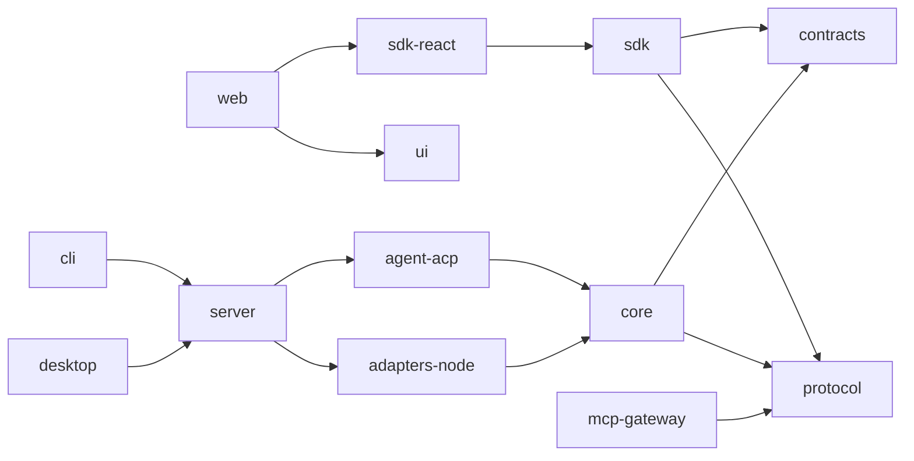

# Monorepo tooling

Root-level files and conventions every package shares. Package-specific
deviations are in each package spec.

## Workspace

| File                                                            | Content                                                                                                                                                                                                                                                                             |
| --------------------------------------------------------------- | ----------------------------------------------------------------------------------------------------------------------------------------------------------------------------------------------------------------------------------------------------------------------------------- |
| `package.json`                                                  | name `flows`, version `0.0.1`, `private: true`, license `Apache-2.0`, `packageManager: "pnpm@11.25.0"`, `engines.node: ">=20.19.0"` (in practice **Node ≥ 22.5** is required because `adapters-node` uses `node:sqlite`; CI uses Node 22; the reference machine runs Node 25.9.0)   |
| `pnpm-workspace.yaml`                                           | `packages: ["apps/*", "packages/*"]`; `allowBuilds: { electron: true, esbuild: true, msw: false }`; `overrides: { "@ts-morph/common>minimatch": "^11.0.1", "@typescript-eslint/typescript-estree>minimatch": "^11.0.1" }`                                                           |
| `turbo.json`                                                    | see below                                                                                                                                                                                                                                                                           |
| `tsconfig.json`                                                 | base: `target ES2022`, `module ESNext`, `moduleResolution bundler`, `skipLibCheck`, `strict`                                                                                                                                                                                        |
| `.prettierrc`                                                   | `endOfLine lf`, `semi false`, `singleQuote false`, `tabWidth 2`, `trailingComma es5`, `printWidth 80`, plugin `prettier-plugin-tailwindcss` with `tailwindStylesheet: packages/ui/src/styles/globals.css` and `tailwindFunctions: ["cn","cva"]`; override `*.mdc` → markdown parser |
| `.prettierignore`                                               | `dist/`, `node_modules/`, `.turbo/`, `coverage/`, `pnpm-lock.yaml`, `.pnpm-store/`, `test-results/`, `playwright-report/`, `blob-report/`, `docs/INDEX.md`, `docs/*/INDEX.md`                                                                                                       |
| `.gitignore`                                                    | logs, `*.log`, `.pnpm*`, `node_modules`, `dist`, `dist-ssr`, `*.local`, `.env*`, `.turbo`, editor dirs (`.vscode/*` except `extensions.json`, `.idea`, `.DS_Store`, …), `*.tsbuildinfo`, `test-results`, `playwright-report`, `blob-report`                                         |
| `eslint-dependency-guards.mjs`                                  | shared lint blocks for layering (below)                                                                                                                                                                                                                                             |
| `scripts/probe-acp-mcp.mjs`                                     | dev-only probe: spawns Cursor `agent acp` (`AGENT_BIN`, default `~/.local/bin/agent`, 90 s timeout) with a trivial stdio MCP server in a temp dir to test whether `session/new` honours `mcpServers`. Not in CI.                                                                    |
| `.cursor/rules/*.mdc`                                           | agent rules: `general`, `clean-code`, `docs`, `engine`, `server`, `testing`, `web` (summarised under Conventions)                                                                                                                                                                   |
| `.github/workflows/security.yml`                                | CI (below)                                                                                                                                                                                                                                                                          |
| `AGENTS.md`, `README.md`, `SECURITY.md`, `LICENSE` (Apache-2.0) |                                                                                                                                                                                                                                                                                     |

Root devDependencies: `eslint-import-resolver-node ^0.4.0`,
`eslint-plugin-import-x ^4.18.1`, `prettier ^3.10.1`,
`prettier-plugin-tailwindcss ^0.8.1`, `turbo ^2.11.13`, `typescript ~6.0.2`.

## Root scripts

| Script                      | Command                                                |
| --------------------------- | ------------------------------------------------------ |
| `build`                     | `turbo build`                                          |
| `dev`                       | `turbo dev` (server + web; persistent, uncached)       |
| `lint`                      | `turbo lint && pnpm docs:check`                        |
| `lint:fix`                  | `turbo lint -- --fix`                                  |
| `format` / `format:check`   | `prettier --write .` / `prettier --check .`            |
| `typecheck`                 | `turbo typecheck`                                      |
| `test`                      | `turbo test` (vitest per package)                      |
| `test:e2e`                  | `turbo test:e2e` (Playwright, uncached)                |
| `docs:index` / `docs:check` | `pnpm -s --filter @workspace/docs-tools run docs index | check` |

## turbo.json

- `ui: "tui"`.
- `globalPassThroughEnv`: `CI`, `FLOWAPP_HOME`, `FLOWAPP_CURSOR_PROJECTS`,
  `FLOWAPP_RETRY_BACKOFF_MS`, `PW_API_PORT`, `PW_WEB_PORT`, `PW_API_BASE`,
  `PW_VIDEO`, `PW_SCREENSHOT`, `PORT`.
- Tasks: `build` (dependsOn `^build`, inputs `$TURBO_DEFAULT$` + `.env*`,
  outputs `dist/**`); `lint` (dependsOn `^lint`); `typecheck` (dependsOn
  `^typecheck`); `dev` (cache false, persistent); `test` (outputs `[]`);
  `test:e2e` (cache false, passThroughEnv `CI`, `FLOWAPP_HOME`,
  `FLOWAPP_CURSOR_PROJECTS`, `PW_WEB_PORT`, `PW_API_PORT`, `PW_API_BASE`,
  `PW_VIDEO`, `PW_SCREENSHOT`).

## Package conventions

- Every workspace package is `"type": "module"`, `private: true`, named
  `@workspace/<name>` (apps: `web`, `server`, `cli`, `desktop`, `e2e`).
- **No build step for libraries**: `exports` map to `./src/*.ts`; internal
  imports carry explicit `.ts` extensions; each tsconfig extends the root
  with `allowImportingTsExtensions: true`, `noEmit: true`, `include: ["src"]`.
- Scripts per package: `typecheck: tsc --noEmit` (web: `tsc -b`),
  `lint: eslint`, `test: vitest run`.
- Common devDependencies: `@eslint/js ^10.0.1`, `eslint ^10.15.0`,
  `globals ^17.14.0`, `typescript ~6.0.3`, `typescript-eslint ^8.73.0`,
  `vitest ^5.1.1`, `@types/node ^26.6.6`.
- Workspace deps use `workspace:*`.

## ESLint

Flat config per package (`eslint.config.js`), built with
`defineConfig` / `globalIgnores(["dist"])` from `eslint/config`:

1. `files: **/*.ts(x)` extends `js.configs.recommended` +
   `tseslint.configs.recommended`, `languageOptions.globals = globals.node`
   (browser for web/ui).
2. `noCycleBlock` from `eslint-dependency-guards.mjs`: registers
   `eslint-plugin-import-x` under the plugin name `import`, typescript
   parser for `.ts/.tsx`, node resolver with `.js .jsx .ts .tsx`, rule
   `import/no-cycle: ["error", { maxDepth: Infinity }]`.
3. `max-lines`: `warn` at 200 (skip blank lines and comments) for source,
   300 for `*.test.*` / `*.spec.*`.
4. Layering via `no-restricted-imports` (from the guards file):

| Export                       | Applied in                            | Forbids                                                                                                                                     |
| ---------------------------- | ------------------------------------- | ------------------------------------------------------------------------------------------------------------------------------------------- |
| `contractsRestrictedImports` | contracts                             | any `@workspace/*`                                                                                                                          |
| `coreRestrictedImports`      | core                                  | `fs`, `node:fs`, `child_process`, `node:child_process`, `better-sqlite3`, any `node:*`                                                      |
| `adaptersRestrictedImports`  | adapters-node, agent-acp, mcp-gateway | `@workspace/adapters-*`, `@workspace/agent-acp(/*)`, `@workspace/mcp-gateway(/*)`                                                           |
| `webRestrictedImports`       | web                                   | `hono/client`, `server/app`, `@workspace/core(/*)`, `@workspace/engine(/*)`, `@workspace/adapters-*`, `@/pages/mock(/*)`, `**/pages/mock/*` |

Messages (verbatim intent): "contracts must not import other workspace
packages", "core must not import node:* modules", "adapters must not import
other adapters", "web must use FCP via sdk-react, not hono/client", "web
must not import core, engine or adapters".

## Dependency direction

Workspace edges (from each `package.json`, deps + devDeps):

| Package                    | Depends on                                            |
| -------------------------- | ----------------------------------------------------- |
| `@workspace/protocol`      | —                                                     |
| `@workspace/contracts`     | —                                                     |
| `@workspace/ui`            | —                                                     |
| `@workspace/docs-tools`    | —                                                     |
| `@workspace/core`          | contracts, protocol                                   |
| `@workspace/adapters-node` | contracts, core, protocol                             |
| `@workspace/agent-acp`     | contracts, core, protocol                             |
| `@workspace/mcp-gateway`   | protocol                                              |
| `@workspace/sdk`           | contracts, protocol                                   |
| `@workspace/sdk-react`     | sdk                                                   |
| `server`                   | adapters-node, agent-acp, contracts, core, protocol   |
| `cli`                      | adapters-node, contracts, protocol, sdk, server       |
| `desktop`                  | adapters-node, contracts, core, protocol, sdk, server |
| `web`                      | contracts, protocol, sdk, sdk-react, ui               |
| `e2e`                      | — (talks HTTP/WS only)                                |

## CI — `.github/workflows/security.yml`

Name `Security`; triggers: `pull_request`, `push` to `develop`, weekly
cron `17 6 * * 1`, `workflow_dispatch`. `permissions: contents: read`;
concurrency group `security-${{ github.ref }}`, cancel in progress.

| Job                               | Steps                                                                                                                                                                                                                                             |
| --------------------------------- | ------------------------------------------------------------------------------------------------------------------------------------------------------------------------------------------------------------------------------------------------- |
| `audit` (ubuntu-latest, 10 min)   | checkout v7.0.1 → pnpm/action-setup v6.1.1 → setup-node v7.1.0 (`node-version: 22`, `cache: pnpm`) → `pnpm install --frozen-lockfile` → `pnpm audit --prod --audit-level=moderate` (gate) → `pnpm audit --audit-level=high` (`continue-on-error`) |
| `secrets` (ubuntu-latest, 10 min) | checkout with `fetch-depth: 0` → `docker run --rm -v "$PWD:/repo" ghcr.io/gitleaks/gitleaks:v8.30.1 git /repo --redact --verbose`                                                                                                                 |

All actions pinned by commit SHA. Lint/typecheck/test are run locally
("Done means" in AGENTS.md), not in CI.

## Conventions (from `.cursor/rules`)

- KISS/YAGNI; files ≤ ~200 code lines (tests ~300); refactors committed
  separately as `refactor: …`.
- TypeScript strict, ESM; validate external input with zod; shared
  types live in `packages/contracts`.
- Bind every server to `127.0.0.1`, never `0.0.0.0`. macOS only.
- App data under `FLOWAPP_HOME`, else `~/.flowapp`.
- Server: Hono routes chained on `app` in `src/app.ts` (side-effect free
  for `app.request()` tests); listen/signals in `src/index.ts`; websockets
  via `upgradeWebSocket` from `@hono/node-server` (not `@hono/node-ws`);
  port from `PORT`, default 8787.
- Web: component sourcing order packages/ui → shadcn → AI Elements →
  custom; add via `pnpm dlx shadcn@latest add <name> -c apps/web`; Base UI
  variants only; `data-testid` on asserted elements; UI changes need a
  Playwright test.
- Tests: vitest next to code; server via `app.request()`; web jsdom +
  Testing Library; e2e in `apps/e2e/tests/*.spec.ts`; prefer role/test-id
  locators; no fixed sleeps.
- Git: branch from `develop`, PRs to `develop`, conventional commits,
  never push to `main` without approval; no person names or secrets in the repo.

## Environment variables (all packages)

| Var                                                                            | Read by                                              | Meaning                                                                       |
| ------------------------------------------------------------------------------ | ---------------------------------------------------- | ----------------------------------------------------------------------------- |
| `FLOWAPP_HOME`                                                                 | adapters-node, server, cli, desktop, e2e             | data root; default `~/.flowapp`                                               |
| `PORT`                                                                         | server                                               | listen port, default `8787`                                                   |
| `FLOWAPP_SANDBOX`                                                              | adapters-node `sandbox.ts`                           | `0` disables `sandbox-exec` wrapping                                          |
| `FLOWAPP_CURSOR_PROJECTS`                                                      | adapters-node `host/cursor-trust.ts`                 | Cursor projects root (trust files); e2e sets `$FLOWAPP_HOME/.cursor-projects` |
| `FLOWAPP_RETRY_BACKOFF_MS`                                                     | turbo passthrough only (no reader in current source) | legacy retry backoff override                                                 |
| `FLOWAPP_FAKE_CONNECTOR`                                                       | server `src/index.ts`                                | `1` registers fake connectors (e2e)                                           |
| `FLOWAPP_LIVE_GH`                                                              | tests                                                | opt in to live GitHub CLI tests                                               |
| `FLOWAPP_WEB_DIST`                                                             | desktop `main.ts`                                    | web build dir, default `../../web/dist` relative to main                      |
| `FLOWAPP_DESKTOP_BUILD`                                                        | web `vite.config.ts`                                 | `1` → Vite `base: "./"` (file loading in Electron)                            |
| `FLOWAPP_REVEAL_STUB`                                                          | desktop `host-shell.ts`                              | write reveal-path calls to a log instead of Finder (smoke tests)              |
| `FLOWS_TEST_TOKEN`                                                             | tests                                                | lock token for test hosts                                                     |
| `PW_WEB_PORT`, `PW_API_PORT`, `PW_API_BASE`, `PW_VIDEO`, `PW_SCREENSHOT`, `CI` | e2e                                                  | Playwright ports and recording modes                                          |
| `STUB_*` (`VERSION`, `TITLE`, `SPACE`, `PAGE`, `MARKDOWN`, `CONFLICT`)         | e2e fixture stub CLIs                                | canned stub output                                                            |
| `AGENT_BIN`                                                                    | `scripts/probe-acp-mcp.mjs`                          | Cursor agent binary                                                           |
| `HOME`, `PATH`                                                                 | adapters-node                                        | default home, binary lookup                                                   |
